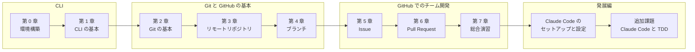

# GitHub と CLI のチュートリアル

Linux / Unix のコマンドライン（CLI）に慣れていない人が、**ターミナルの基本操作** から、**Git によるソースコードの管理**、そして GitHub の **Issue・ブランチ・Pull Request を使ったチーム開発の流れ** までを、手を動かしながら学ぶための教材です。
開発には **VS Code** を使い、Git の操作は **VS Code の画面とコマンドの両方** で学びます。
[発展編](docs/claude-code/README.md) では、AI のコーディングエージェント **Claude Code** と一緒に、テスト駆動開発（TDD）で機能を作ります。

## 対象の読者

- ターミナル（黒い画面）を使ったことがない、または少し触ったことがある程度の人
- Git や GitHub の名前は知っているが、使い方に自信がない人
- VS Code を使ったことがない、または使い始めたばかりの人
- チームでの開発に参加する前に、Issue や Pull Request の基本を身に付けたい人

プログラミングの経験は必要ありません。

## この教材で学べること

- VS Code の画面の見方と、開発に使う拡張機能の入れ方
- ターミナルでファイルを操作し、コマンドを組み合わせて使う方法
- Git で変更履歴を記録し、取り消したり、ブランチで並行して作業したりする方法
- GitHub にリポジトリを作り、push / pull で共有する方法
- Issue で課題を管理し、Pull Request でレビューと自動テストを通してから変更を取り込む方法
- 困ったときに、エラーメッセージを読んで自分で対処する方法
- （発展編）Claude Code の設定（CLAUDE.md・skill・subagent・フック）と、AI と一緒に進めるテスト駆動開発

## 必要なもの

| 項目 | 内容 |
| --- | --- |
| PC | macOS、Linux、または Windows 10 / 11（WSL2 を使います） |
| ツール | Git 2.28 以上、GitHub CLI（`gh`）、Visual Studio Code（VS Code）。インストール方法は [第 0 章](docs/00-setup.md) で説明します |
| アカウント | GitHub アカウント（無料） |
| 発展編のみ | Claude の有料プラン（Pro / Max など）と Claude Code。詳しくは [発展編](docs/claude-code/README.md) を参照してください |

## カリキュラム



| 章 | 内容 | 目安時間 |
| --- | --- | --- |
| [第 0 章: 環境構築](docs/00-setup.md) | ターミナル・Git・GitHub CLI・VS Code の準備、VS Code の画面と用語、拡張機能、教材の取得 | 60〜90 分 |
| [第 1 章: CLI の基本](docs/01-cli-basics.md) | ディレクトリの移動、ファイル操作（エクスプローラーとコマンド）、パイプとリダイレクト、ファイルの編集 | 60〜90 分 |
| [第 2 章: Git の基本](docs/02-git-basics.md) | 初期設定、add / commit、status / diff / log、.gitignore、変更の取り消し（ソース管理ビューとコマンド） | 60〜90 分 |
| [第 3 章: GitHub とリモートリポジトリ](docs/03-github-remote.md) | 認証、push / clone / pull / fetch、push が拒否されたときの対処 | 60〜90 分 |
| [第 4 章: ブランチ](docs/04-branch.md) | ブランチの作成と切り替え、マージ、コンフリクトの解消 | 60〜90 分 |
| [第 5 章: Issue](docs/05-issue.md) | 練習用リポジトリの準備、良い Issue の書き方、ラベル、テンプレート | 45〜60 分 |
| [第 6 章: Pull Request](docs/06-pull-request.md) | PR の作成、Issue との関連付け、レビュー、CI、マージと後片付け | 60〜90 分 |
| [第 7 章: 開発フローの総合演習](docs/07-github-flow.md) | GitHub Flow に沿った機能追加、チャレンジ課題、チームでの練習 | 90〜180 分 |
| [第 8 章: 困ったときは](docs/08-troubleshooting.md) | よくあるトラブルと対処方法（必要なときに参照） | - |

合計で **9〜13 時間** 程度です。1 日 1〜2 章ずつ進めるのがおすすめです。

### 発展編: Claude Code と TDD

本編を終えた人向けの追加の教材です。Claude の有料プランが必要です。

| 章 | 内容 | 目安時間 |
| --- | --- | --- |
| [発展編の目次](docs/claude-code/README.md) | 前提、費用の注意、この発展編で作る「ハーネス」、困ったときは | - |
| [第 1 章: Claude Code のセットアップ](docs/claude-code/01-setup.md) | インストール、ログイン、VS Code での使い方、基本の操作、安全に使うための心得 | 45〜60 分 |
| [第 2 章: CLAUDE.md と AGENTS.md](docs/claude-code/02-claude-md.md) | プロジェクトの決まりを伝えるファイルの書き方 | 45〜60 分 |
| [第 3 章: モデルと effort の選び方](docs/claude-code/03-models-and-effort.md) | モデルの種類、effort、作業に合わせた選び方 | 30〜45 分 |
| [第 4 章: skill と subagent](docs/claude-code/04-skills-and-agents.md) | TDD 用の skill と、テストをレビューする subagent を作る | 60〜90 分 |
| [第 5 章: ハーネスを整える](docs/claude-code/05-harness.md) | 権限モード、plan モード、権限の設定、フック、`/goal` と `/loop` による検証ループ | 60〜90 分 |
| [第 6 章: 追加課題: t-wada 流 TDD で stats コマンドを作る](docs/claude-code/06-tdd.md) | テストリスト、Red → Green → Refactor、仮実装と三角測量、レビュー | 90〜180 分 |

### 付録

- [CLI チートシート](docs/appendix/cli-cheatsheet.md)
- [Git / GitHub CLI チートシート](docs/appendix/git-cheatsheet.md)
- [用語集](docs/appendix/glossary.md)
- [コミットメッセージの書き方](docs/appendix/commit-message.md)

## 学習の進め方

1. **第 0 章から順番に** 進めてください。後の章は、前の章で作ったリポジトリや設定を使います。
2. 本文のコマンドは、**読むだけでなく必ず自分で実行** してください。コマンドは VS Code の統合ターミナルで実行します。出力例と見比べながら進めると理解が深まります。
3. Git の操作は、「**VS Code で操作する**」と「**コマンドで操作する**」の 2 つの方法を並べて説明しています。まずはどちらか一方で進め、慣れてきたらもう一方も試して、同じ結果になることを確かめてみましょう。
4. 各章の最後にある **演習** に取り組みます。解答例は `▶ 解答例` をクリックすると表示されます。まずは見ずに挑戦してみましょう。
5. エラーが出たら、まずメッセージを読み、[第 8 章: 困ったときは](docs/08-troubleshooting.md) を確認します。
6. 演習の一覧は [exercises/README.md](exercises/README.md) にまとめています。

> [!TIP]
> 練習用のリポジトリ（`~/git-practice/` 以下）や練習用環境は、何度壊しても作り直せます。
> 失敗を恐れずに、いろいろなコマンドを試してみてください。

## 表記のルール

### コマンドと出力

入力するコマンドは、次のように書きます。そのままコピーして実行できます。`#` から後ろはコメントです。

```bash
git status    # 状態を確認する
```

コマンドの出力（実行結果）は、次のように書きます。コマンドと出力をあわせて示すときは、入力した行の先頭に `$` を付けます（`$` は入力しません）。

```text
$ git --version
git version 2.43.0
```

出力は、環境やバージョンによって多少異なることがあります。

### 置き換える部分

`<あなたのユーザー名>` のように `< >` で囲まれた部分は、自分の環境に合わせて置き換えてください（`< >` は入力しません）。

```bash
# 例: ユーザー名が hanako の場合
git clone https://github.com/<あなたのユーザー名>/my-first-repo.git
# ↓
git clone https://github.com/hanako/my-first-repo.git
```

### ボタン名

GitHub の画面のボタンやメニューは、英語表示での名前を **太字** で書きます（例: 「**New repository**」）。
GitHub の画面は改善のために変わることがあるので、見つからないときは似た名前のボタンを探してください。

VS Code のボタンやメニューは、日本語表示での名前を **太字** で書き、英語表示での名前を（）で添えます（例: 「**ソース管理**（Source Control）」）。
VS Code は毎週のように更新されるため、日本語になっていない新しい表示もあります。見つからないときは、英語の名前でも探してください。

### キー操作

キーは <kbd>Ctrl</kbd> + <kbd>S</kbd> のように書きます。OS によって違う場合は、Windows / Linux のキーを先に書き、macOS のキーを（）で添えます（例: <kbd>Ctrl</kbd> + <kbd>S</kbd>（macOS は <kbd>Command</kbd> + <kbd>S</kbd>））。

## リポジトリの構成

```text
.
├── README.md               # このファイル（目次）
├── CONTRIBUTING.md         # 教材の改善に協力してくれる方へ
├── docs/                   # 教材の本文
│   ├── 00-setup.md 〜 08-troubleshooting.md
│   ├── claude-code/        # 発展編（Claude Code と TDD）
│   └── appendix/           # チートシート・用語集など
├── samples/
│   ├── cli-practice/       # 第 1 章で使う CLI 練習用ファイル
│   ├── todo-cli/           # 第 5〜7 章と発展編で使うサンプルアプリ（シェルスクリプト製の TODO 管理ツール）
│   └── claude-harness/     # 発展編で作る Claude Code の設定（ハーネス）の完成例
├── exercises/
│   ├── README.md           # 演習の一覧
│   └── scripts/            # 練習用環境（コンフリクト・チーム開発）を作るスクリプト
├── .vscode/                # この教材を VS Code で開いたときの、おすすめの拡張機能と設定
└── .github/
    ├── ISSUE_TEMPLATE/     # この教材への Issue のテンプレート
    ├── pull_request_template.md
    └── workflows/ci.yml    # 教材のチェック（Markdown の lint、shellcheck、テスト、JSON の検証）
```

### サンプルアプリ: todo-cli

[samples/todo-cli](samples/todo-cli/) は、Issue → ブランチ → Pull Request の流れを練習するための小さな TODO 管理ツールです。
**自分の GitHub アカウントに練習用リポジトリとしてコピーして使う** ことを前提に、次のものを同梱しています。

- テスト（`tests/test_todo.sh`）
- VS Code の設定（おすすめの拡張機能、テストを実行するタスク）
- Issue テンプレート（バグ報告・機能リクエスト）と Pull Request テンプレート
- Pull Request ごとにテストを自動実行する GitHub Actions の設定

練習用に、あえて残してある不具合や、追加する機能の課題も用意しています。詳しくは [samples/todo-cli/README.md](samples/todo-cli/README.md) を参照してください。

## 質問・フィードバック

教材の誤り、分かりにくい説明、質問、改善の提案は、[Issue](https://github.com/kotonara-tech/github-and-cli-tutorials/issues/new/choose) からお寄せください。
テンプレートを選ぶと、書くべき項目が表示されます。

教材の修正に協力していただける場合は、[CONTRIBUTING.md](CONTRIBUTING.md) を参照してください。
