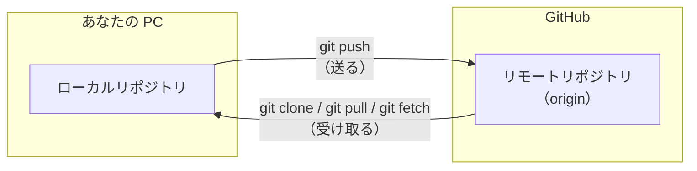

# 第 3 章: GitHub とリモートリポジトリ

第 2 章では、自分の PC の中だけでコミットを記録しました。
この章では、そのリポジトリを GitHub にアップロードし、ほかの PC や他の人と共有する方法を学びます。

## この章のゴール

- [ ] ローカルリポジトリとリモートリポジトリの違いを説明できる
- [ ] GitHub にリポジトリを作り、`git push` でコミットを送れる
- [ ] `git clone` でリポジトリを複製できる
- [ ] `git pull` / `git fetch` でリモートの変更を取り込める
- [ ] VS Code の **変更の同期** に表示される ↓ と ↑ の数字の意味を説明できる
- [ ] push が拒否されたときに、落ち着いて対処できる

**所要時間の目安:** 60〜90 分

## 3.1 リモートリポジトリとは

自分の PC の中にあるリポジトリを **ローカルリポジトリ**、GitHub などのサーバー上にあるリポジトリを **リモートリポジトリ** と呼びます。



| コマンド | VS Code での操作 | 動作 |
| --- | --- | --- |
| `git clone` | コマンド パレットの「**Git: クローン**」（Git: Clone） | リモートリポジトリを、履歴ごと丸ごと手元に複製する（最初の 1 回） |
| `git push` | **Branch の発行**（Publish Branch）、**プッシュ**（Push） | ローカルのコミットをリモートに送る |
| `git fetch` | **フェッチ**（Fetch） | リモートの新しいコミットを受け取る（作業中のファイルは変えない） |
| `git pull` | **プル**（Pull） | リモートの新しいコミットを受け取り、作業中のブランチに取り込む（`fetch` + `merge`） |

VS Code には、プルとプッシュを続けて行う **変更の同期**（Sync Changes）というボタンもあります。それぞれの使い方は、この章の各節で説明します（[公式ドキュメント: Working with repositories and remotes](https://code.visualstudio.com/docs/sourcecontrol/repos-remotes)）。

リモートリポジトリには名前を付けて管理します。clone したときの接続先には、慣習的に **`origin`** という名前が付きます。

> [!NOTE]
> Git と GitHub は別物です。**Git** は履歴を管理する「ツール」、**GitHub** は Git のリポジトリを預けて共有するための「Web サービス」です。
> Git は GitHub がなくても使えますし、GitHub の代わりに GitLab や Bitbucket などのサービスを使うこともできます。

## 3.2 GitHub への接続（認証）の仕組み

GitHub に `git push` するには、「あなたがそのリポジトリに書き込んでよい人か」を確認する **認証** が必要です。
接続方法には **HTTPS** と **SSH** の 2 種類があります。

### HTTPS（この教材のおすすめ）

[第 0 章](00-setup.md) で `gh auth login` を実行したとき、「Authenticate Git with your GitHub credentials?」に `Yes` と答えました。
これにより、`git` が GitHub に接続するときに `gh` のログイン情報を使うよう設定されています。追加の作業は必要ありません。

VS Code の **ソース管理**（Source Control）ビューから push や pull をするときも、VS Code は内部で `git` コマンドを実行しています。
そのため、`gh auth login` で設定したログイン情報がそのまま使われ、VS Code で追加の設定をする必要はありません（[公式ドキュメント: Credential helpers](https://code.visualstudio.com/docs/sourcecontrol/repos-remotes#_credential-helpers)）。

VS Code が、GitHub へのサインインを求めることもあります（たとえば、3.5 の「**GitHub から複製**」を選んだときや、[第 5 章](05-issue.md) で使う GitHub Pull Requests 拡張機能を使い始めるとき）。
これは、VS Code や拡張機能が GitHub の機能を使うためのものなので、許可して構いません。ブラウザが開いたら、GitHub の画面で認証を許可します。

> [!IMPORTANT]
> GitHub では、`git push` のときに **GitHub のパスワードを入力しても認証できません**（2021 年に廃止されました）。
> パスワードを聞かれて先に進めない場合は、`gh auth login` をやり直すか、次のコマンドを実行してください。
>
> ```bash
> gh auth setup-git
> ```

### SSH（参考）

SSH では、PC で作った **鍵のペア**（秘密鍵と公開鍵）のうち、公開鍵を GitHub に登録して認証します。
HTTPS で問題なく使えていれば、設定する必要はありません。

```bash
# 1. 鍵のペアを作る（質問にはすべて Enter で答えてよい。パスフレーズは設定を推奨）
ssh-keygen -t ed25519 -C "<メールアドレス>"

# 2. 公開鍵（.pub の方）を GitHub に登録する
gh ssh-key add ~/.ssh/id_ed25519.pub --title "my-laptop"

# 3. 接続を確認する
ssh -T git@github.com
```

`Hi <ユーザー名>! You've successfully authenticated...` と表示されれば成功です。

手順 2 で権限（scope）が足りないというエラーが出た場合は、次のコマンドで `gh` に鍵を登録する権限を追加してから、もう一度実行してください。

```bash
gh auth refresh -h github.com -s admin:public_key
```

> [!WARNING]
> `~/.ssh/id_ed25519`（`.pub` が付いていない方）は **秘密鍵** です。他人に渡したり、GitHub に登録したりしてはいけません。

## 3.3 GitHub にリポジトリを作って push する

第 2 章で作った `~/git-practice/my-first-repo` を GitHub にアップロードします。
ブラウザで操作する方法と、`gh` コマンドを使う方法があります。**どちらか一方** を実行してください。

> [!NOTE]
> VS Code には、GitHub にリポジトリを作って push するまでを 1 回で行う「**GitHub に公開**」（Publish to GitHub）という機能もあります（[公式ドキュメント: Publish to GitHub](https://code.visualstudio.com/docs/sourcecontrol/repos-remotes#_publish-to-github)）。
> この教材では、先に GitHub でリポジトリを作ってから push する流れを学ぶため、この機能は使いません。

### 方法 1: ブラウザで作る

1. GitHub の右上の「**+**」→「**New repository**」をクリックします。
2. 次のように入力します。
   - **Repository name**: `my-first-repo`
   - **Visibility**: `Private`（自分と招待した人だけが見られる）
   - **Add README** や **.gitignore**、**license** は **すべてオフ** のままにします（手元にすでにリポジトリがあるため）
3. 「**Create repository**」をクリックします。
4. 表示された画面の「**…or push an existing repository from the command line**」に、手元のリポジトリを push するためのコマンドが表示されます。次のどちらかの方法で push します。

#### VS Code で操作する

1. VS Code で `~/git-practice/my-first-repo` を開きます（**ファイル**（File）> **フォルダーを開く...**（Open Folder...）、または `code ~/git-practice/my-first-repo`）。制限モードで開いた場合は、[0.8](00-setup.md#フォルダを信頼する制限モードを解除する) の手順で信頼します。
2. 統合ターミナルで、GitHub の画面に表示されている `git remote add` のコマンドを実行し、GitHub のリポジトリを `origin` という名前で登録します。

   ```bash
   git remote add origin https://github.com/<あなたのユーザー名>/my-first-repo.git
   ```

3. **ソース管理**（Source Control）ビューを開きます（<kbd>Ctrl</kbd> + <kbd>Shift</kbd> + <kbd>G</kbd>（macOS は <kbd>Control</kbd> + <kbd>Shift</kbd> + <kbd>G</kbd>））。`main` ブランチはまだ GitHub に送ったことがないので、**Branch の発行**（Publish Branch）というボタンが表示されています。ステータス バーのブランチ名の右にも、雲の形のアイコンが表示されます。
4. **Branch の発行** をクリックします。登録したリモートは `origin` だけなので、そのまま `origin` に push されます。これは `git push -u origin main` と同じ操作です。

push が終わると、ボタンの表示が **コミット**（Commit）に戻り、ステータス バーの雲のアイコンが、矢印が円を描く形の同期のアイコンに変わります。

`git remote add` を実行する前に **Branch の発行** をクリックすると、登録されたリモートがないため、VS Code は「GitHub に公開」の手順を始めて、GitHub に新しいリポジトリを作ろうとします。
画面の上部にリポジトリ名の入力欄が表示されたら、<kbd>Esc</kbd> で取り消して（GitHub へのサインインを求められた場合は、キャンセルして）、手順 2 からやり直してください。

#### コマンドで操作する

GitHub の画面に表示されているコマンドを、統合ターミナルで実行します。

```bash
cd ~/git-practice/my-first-repo
git remote add origin https://github.com/<あなたのユーザー名>/my-first-repo.git
git branch -M main
git push -u origin main
```

| コマンド | 意味 |
| --- | --- |
| `git remote add origin <URL>` | `<URL>` のリモートリポジトリを `origin` という名前で登録する |
| `git branch -M main` | 今のブランチの名前を `main` にする（すでに `main` なら何も変わらない） |
| `git push -u origin main` | `main` ブランチを `origin` に送る。`-u` は「今後このブランチは `origin` の `main` と対応させる」という設定で、次からは `git push` だけで送れるようになる |

### 方法 2: gh コマンドで作る

```bash
cd ~/git-practice/my-first-repo
gh repo create my-first-repo --private --source=. --remote=origin --push
```

| オプション | 意味 |
| --- | --- |
| `--private` | 非公開のリポジトリにする（公開する場合は `--public`） |
| `--source=.` | 今いるディレクトリのリポジトリを元にする |
| `--remote=origin` | リモートを `origin` という名前で登録する |
| `--push` | 作成後すぐに push する |

出力例:

```text
✓ Created repository hanako/my-first-repo on github.com
  https://github.com/hanako/my-first-repo
✓ Added remote https://github.com/hanako/my-first-repo.git
✓ Pushed commits to https://github.com/hanako/my-first-repo.git
```

### 確認する

ブラウザで GitHub のリポジトリのページを開きます。`gh` を使うと、ターミナルから開けます。

```bash
gh browse
```

`README.md` の内容がページの下部に表示され、「**commits**」のリンクからコミットの履歴を確認できます。

登録されているリモートリポジトリは、次のコマンドで確認できます。

```bash
git remote -v
```

```text
origin  https://github.com/hanako/my-first-repo.git (fetch)
origin  https://github.com/hanako/my-first-repo.git (push)
```

## 3.4 変更を push する

2 回目以降は、「編集 → ステージ（`git add`）→ コミット → push」の流れになります。
編集からコミットまでは、[第 2 章](02-git-basics.md) と同じです。

### VS Code で操作する

1. エクスプローラーで `README.md` を開き、最後に `- GitHub に push できた` という行を追加して保存します（<kbd>Ctrl</kbd> + <kbd>S</kbd>（macOS は <kbd>Command</kbd> + <kbd>S</kbd>））。
2. **ソース管理**（Source Control）ビューで、`README.md` の右の **+**（**変更をステージ**（Stage Changes））をクリックします。
3. メッセージ欄に `README に進捗を追記` と入力し、**コミット**（Commit）をクリックします。
4. ボタンの表示が **変更の同期**（Sync Changes）に変わり、右に `1↑` と表示されます。**変更の同期** をクリックすると push されます。

**変更の同期** をクリックすると、「このアクションは、"origin/main" との間でコミットをプルおよびプッシュします。」という確認が表示されます。**OK** を選んでください（**OK、今後は表示しない** を選ぶと、次からは確認されなくなります）。

ボタンやステータス バーの矢印と数字は、次の意味です。ステータス バーでは、ブランチ名の右に `0↓ 1↑` のように表示されます。

| 表示 | 意味 |
| --- | --- |
| ↑ と数字 | 手元にあって、まだ push していないコミットの数（`git status` の `ahead`） |
| ↓ と数字 | リモートにあって、まだ手元に取り込んでいないコミットの数（`git status` の `behind`）。最後にフェッチしたときの情報です |

**変更の同期** は「プルしてから、プッシュする」ボタンです。push だけをしたいときは、次のどちらかを使います（[公式ドキュメント: Push, pull, and sync](https://code.visualstudio.com/docs/sourcecontrol/repos-remotes#_push-pull-and-sync)）。

- ビューの上部の **…**（**その他の操作...**（More Actions...））から **プッシュ**（Push）を選ぶ
- **コミット** ボタンの右の **∨** から **コミットしてプッシュ**（Commit & Push）を選び、コミットと push を一度に行う

push できたかどうかは、`git status` でも確認できます。`Your branch is up to date with 'origin/main'.` と表示されれば、リモートと同じ状態です。

### コマンドで操作する

```bash
echo "- GitHub に push できた" >> README.md
git add README.md
git commit -m "README に進捗を追記"
git push
```

`git status` を実行すると、ローカルとリモートの差も教えてくれます（次の出力は、`git push` を実行する前のものです）。

```text
$ git status
On branch main
Your branch is ahead of 'origin/main' by 1 commit.
  (use "git push" to publish your local commits)
```

`ahead of 'origin/main' by 1 commit` は「リモートよりローカルの方が 1 コミット進んでいる（まだ push していない）」という意味です。VS Code の `1↑` と同じ情報です。

> [!WARNING]
> 一度 push したコミットは、他の人が取り込んでいる可能性があります。push した後に履歴を書き換える操作（`git commit --amend` や VS Code の **コミット (修正)**（Commit (Amend)）、`git reset`、`git push --force` など）は避けましょう。
> 間違えて push した場合の対処は [第 8 章](08-troubleshooting.md) を参照してください。

## 3.5 リポジトリを複製する（git clone）

別の PC で作業するときや、他の人のリポジトリで作業するときは clone を使います。
ここでは、同じ PC の別の場所に clone して「もう 1 台の PC」の代わりにしてみましょう。

### VS Code で操作する

VS Code では、コマンド パレットの「**Git: クローン**」（Git: Clone）で clone できます（[公式ドキュメント: Clone repositories](https://code.visualstudio.com/docs/sourcecontrol/repos-remotes#_clone-repositories)）。

1. コマンド パレットを開き（<kbd>Ctrl</kbd> + <kbd>Shift</kbd> + <kbd>P</kbd>（macOS は <kbd>Command</kbd> + <kbd>Shift</kbd> + <kbd>P</kbd>））、`clone` と入力して「**Git: クローン**」を選びます。
2. リポジトリの URL（例: `https://github.com/<ユーザー名>/<リポジトリ名>.git`）を貼り付けて <kbd>Enter</kbd> を押します。
   URL の代わりに「**GitHub から複製**」（Clone from GitHub）を選ぶと、GitHub にサインインしたあと、リポジトリの一覧から選べます。
3. clone 先の親フォルダーを選ぶ画面が開きます。親フォルダー（例: `~/git-practice`）を選び、**リポジトリの宛先として選択**（Select as Repository Destination）をクリックします。フォルダー名には、リポジトリ名が使われます。
4. 「リポジトリを開きますか?」と表示されたら、**新しいウィンドウで開く**（Open in New Window）を選びます。今のウィンドウはそのまま残るので、2 つのリポジトリを行き来できます（**開く**（Open）を選ぶと、今のウィンドウで開き直します。**ワークスペースに追加** は使いません）。

> [!NOTE]
> VS Code は、一度開いたことがあるリポジトリの URL を覚えています。その URL を「**Git: クローン**」に入力すると、もう一度 clone するのではなく、手元にあるフォルダ（ここでは `my-first-repo`）を開こうとします（そのフォルダを今のウィンドウで開いているときは、何も起きません）。
> この節のように、**同じリポジトリを別の場所にもう 1 つ clone する** ときは、次の「コマンドで操作する」の方法を使ってください。
> 「**Git: クローン**」は、[第 7 章](07-github-flow.md) で他の人のリポジトリを clone するときのように、初めて手元に用意するリポジトリで使えます。

### コマンドで操作する

```bash
cd ~/git-practice
git clone https://github.com/<あなたのユーザー名>/my-first-repo.git my-first-repo-2
```

最後の `my-first-repo-2` は clone 先のディレクトリ名です（省略するとリポジトリ名になります）。
`gh` を使う場合は、次のように `<ユーザー名>/<リポジトリ名>` だけで指定できます。

```bash
gh repo clone <あなたのユーザー名>/my-first-repo my-first-repo-2
```

clone したら、VS Code で開きます。`code` でフォルダを指定すると、新しいウィンドウで開きます。

```bash
code my-first-repo-2
```

clone したリポジトリには、最初から `origin` が登録されています。

## 3.6 リモートの変更を取り込む（git pull / git fetch）

### GitHub 上でファイルを編集する

1. ブラウザで `my-first-repo` のページを開き、`README.md` をクリックします。
2. 右上の鉛筆アイコン（Edit this file）をクリックします。
3. 1 行追記して、「**Commit changes...**」→「**Commit changes**」をクリックします。

これで、リモートリポジトリにだけ新しいコミットがある状態になりました。

### git pull で取り込む

#### VS Code で操作する

1. `my-first-repo` を開いている VS Code のウィンドウで、**ソース管理**（Source Control）ビューを開きます。
2. ビューの上部の **…**（**その他の操作...**（More Actions...））をクリックし、**プル**（Pull）を選びます。
3. エクスプローラーで `README.md` を開き、GitHub で追記した行が反映されていることを確認します。

ステータス バーのブランチ名の右にある同期のアイコンをクリックしても取り込めます。これは **変更の同期**（Sync Changes）と同じ操作です。
変更の同期は「プル → プッシュ」を続けて行う操作なので、手元にまだ push していないコミットがあれば、取り込んだあとに続けて push されます。

#### コマンドで操作する

```bash
cd ~/git-practice/my-first-repo
git pull
```

```text
From https://github.com/hanako/my-first-repo
   1d5c482..8e4f2a1  main       -> origin/main
Updating 1d5c482..8e4f2a1
Fast-forward
 README.md | 1 +
 1 file changed, 1 insertion(+)
```

`cat README.md` で、GitHub で追記した行が反映されていることを確認しましょう。

### git fetch で確認してから取り込む

`git pull` は「受け取る（fetch）」と「取り込む（merge）」を一度に行います。
取り込む前に何が変わったのかを確認したい場合は、2 段階に分けて実行します。
もう一度 GitHub 上で `README.md` を編集してから、試してみましょう。

fetch で受け取ったリモートの状態は、`origin/main` という名前で手元に記録されます。
`origin/main` は **リモート追跡ブランチ** と呼ばれ、「最後に fetch したときのリモートの main の状態」を表します。

#### VS Code で操作する

[0.10](00-setup.md#git-の自動フェッチはオフのままにする) で自動フェッチをオフのままにしたので、VS Code は自分からはリモートを確認しません。
GitHub に新しいコミットがあっても、フェッチするまでは ↓ の数字は増えません。

1. **ソース管理** ビューの **…** > **フェッチ**（Fetch）を選びます。作業中のファイルは変わりません。
2. ステータス バーのブランチ名の右に `1↓ 0↑` と表示され、ソース管理ビューには **変更の同期 1↓** のボタンが表示されます。↓ は、`origin/main` にあって、まだ手元の `main` に取り込んでいないコミットの数です。
3. ソース管理ビューの **グラフ**（Graph）を見ます。`origin/main` のラベルが付いたコミットと、**受信した変更点**（Incoming Changes）という項目が表示されます。コミットや **受信した変更点** をクリックすると変更されたファイルの一覧が表示され、ファイルをクリックすると差分を確認できます（[公式ドキュメント: Understand incoming and outgoing commits](https://code.visualstudio.com/docs/sourcecontrol/history#_understand-incoming-and-outgoing-commits)）。
4. 内容を確認したら、コマンド パレットで「**Git: マージ...**」（Git: Merge...）を実行し、一覧から `origin/main` を選んで取り込みます。**…** > **プル** や **変更の同期** で取り込んでも構いません。

#### コマンドで操作する

```bash
git fetch                      # リモートの変更を受け取る（作業中のファイルは変わらない）
git log --oneline main..origin/main   # リモートにだけあるコミットを表示する
git diff main origin/main      # 差分を確認する
git merge origin/main          # 取り込む
```

> [!TIP]
> **作業を始める前にプル（`git pull`）** する習慣を付けましょう。古い状態のまま作業を進めると、後で他の人の変更とぶつかりやすくなります。

## 3.7 push が拒否されたら

他の人（または別の PC の自分）が先に push していると、あなたの push は拒否されます。
「リモートに、あなたの手元にないコミットがある」という意味です。
慌てずに、**先にプル（`git pull`）でリモートの変更を取り込んでから**、もう一度 push します。

### VS Code で操作する

**…**（**その他の操作...**（More Actions...））の **プッシュ**（Push）で push したときに拒否されると、画面の中央に次のエラーが表示されます。

- 日本語の表示: 「参照仕様をリモートにプッシュできません。最初に "Pull" を実行して変更を統合してください。」
- 英語の表示: 「Can't push refs to remote. Try running "Pull" first to integrate your changes.」

**コマンド出力を表示する**（Show Command Output）を選ぶと、下の「コマンドで操作する」と同じ、Git の詳しいメッセージを確認できます。

1. エラーのダイアログを閉じます。
2. **…** > **プル**（Pull）を選び、リモートの変更を取り込みます。マージコミットが必要な場合、VS Code ではエディタは開かず、`Merge branch 'main' of ...` というメッセージでマージコミットが自動で作られます。
3. **変更の同期**（Sync Changes）ボタン（または **…** > **プッシュ**）で、もう一度 push します。

**変更の同期** で push した場合は、先にプルしてからプッシュするので、この拒否はほとんど起きません。

### コマンドで操作する

```text
$ git push
To https://github.com/hanako/my-first-repo.git
 ! [rejected]        main -> main (fetch first)
error: failed to push some refs to 'https://github.com/hanako/my-first-repo.git'
hint: Updates were rejected because the remote contains work that you do not
hint: have locally. This is usually caused by another repository pushing to
hint: the same ref. If you want to integrate the remote changes, use
hint: 'git pull' before pushing again.
hint: See the 'Note about fast-forwards' in 'git push --help' for details.
```

次のように、プルしてからもう一度 push します。

```bash
git pull
git push
```

ターミナルで `git pull` を実行したときに VS Code のタブ（`MERGE_MSG`）が開いたら、それは自動で作られる **マージコミット** のメッセージを編集する画面です。ターミナルには `hint: Waiting for your editor to close the file...` と表示され、タブが閉じられるのを待っています。
メッセージはそのままで構わないので、保存して（<kbd>Ctrl</kbd> + <kbd>S</kbd>（macOS は <kbd>Command</kbd> + <kbd>S</kbd>））からタブを閉じます（<kbd>Ctrl</kbd> + <kbd>W</kbd>（macOS は <kbd>Command</kbd> + <kbd>W</kbd>））。タブを閉じると、`git pull` の続きが実行されます。
Git のエディタを nano にしている場合は <kbd>Ctrl</kbd> + <kbd>X</kbd>、vim の場合は <kbd>Esc</kbd> → `:wq` で閉じます。

> [!CAUTION]
> エラーを消すために `git push --force` を使ってはいけません。リモートにある **他の人のコミットを消してしまいます**。

両方が同じ行を変更していた場合は **コンフリクト（競合）** が発生します。解消方法は [第 4 章](04-branch.md) で学びます。

## 3.8 GitHub のリポジトリ画面の見方

| タブ | 内容 |
| --- | --- |
| **Code** | ファイルの一覧と `README.md` の内容。ブランチの切り替えやコミット履歴の確認もここから |
| **Issues** | やること・バグ・要望などを管理する（[第 5 章](05-issue.md)） |
| **Pull requests** | 変更の提案とレビュー（[第 6 章](06-pull-request.md)） |
| **Actions** | テストなどの自動実行（CI）の結果 |
| **Settings** | リポジトリの設定（公開範囲、メンバーの招待、ブランチの保護など） |

> [!NOTE]
> **フォーク（Fork）** は、他の人のリポジトリを自分のアカウントにコピーする機能です。オープンソースのプロジェクトに貢献するときによく使います。
> この教材では、フォークの代わりに自分のアカウントで新しくリポジトリを作って練習します。

## 演習

### 演習 3-1: GitHub に push する

本文の [3.3](#33-github-にリポジトリを作って-push-する) と [3.4](#34-変更を-push-する) の手順で、`my-first-repo` を GitHub に push し、ブラウザでコミット履歴を確認してください。

### 演習 3-2: 2 つの clone を行き来する

1. 本文の [3.5](#35-リポジトリを複製するgit-clone) の手順で、`my-first-repo-2` に clone し、VS Code の新しいウィンドウで開いてください。
2. `my-first-repo-2` で `profile.md` を編集してコミットし、push してください。
3. `my-first-repo` でプル（`git pull`）して、変更が反映されることを確認してください。

<details>
<summary>解答例</summary>

VS Code で操作する場合は、次のとおりです。

1. `my-first-repo-2` のウィンドウで `profile.md` を開き、最後に `- 特技: タイピング` を追加して保存します。
2. **ソース管理**（Source Control）ビューで `profile.md` の **+**（**変更をステージ**（Stage Changes））をクリックし、メッセージ `自己紹介に特技を追加` でコミットします。
3. **変更の同期 1↑**（Sync Changes）をクリックして push します。
4. `my-first-repo` のウィンドウに切り替え、**…** > **プル**（Pull）を選びます。`profile.md` に `- 特技: タイピング` が追加されていることを確認します。

コマンドで操作する場合は、次のとおりです。

```bash
cd ~/git-practice/my-first-repo-2
echo "- 特技: タイピング" >> profile.md
git add profile.md
git commit -m "自己紹介に特技を追加"
git push

cd ~/git-practice/my-first-repo
git pull
cat profile.md
```

</details>

### 演習 3-3: push が拒否される状況を体験する

GitHub の代わりに PC の中に「リモートリポジトリ」を作り、Alice さんと Bob さんの 2 人で開発する状況を再現します。

```bash
cd ~
bash ~/github-and-cli-tutorials/exercises/scripts/make-team-sandbox.sh
```

`alice` と `bob` は、それぞれ別の VS Code のウィンドウで開き、2 人の PC の代わりにします。

```bash
code ~/team-sandbox/alice
code ~/team-sandbox/bob
```

コマンドの代わりに、メニューの **ファイル**（File）> **新しいウィンドウ**（New Window）で新しいウィンドウを開き、**フォルダーを開く...** で `alice` と `bob` をそれぞれ開いても構いません。

`~/team-sandbox` はスクリプトが新しく作ったフォルダなので、制限モードで開きます。[0.8](00-setup.md#フォルダを信頼する制限モードを解除する) の手順で、それぞれのウィンドウで信頼してください。
**信頼済みフォルダーとワークスペース** に `~/team-sandbox` を追加しておくと、中の `alice` と `bob` がまとめて信頼されます（親のフォルダーがすでに信頼済みなら、制限モードにはなりません）。

1. `alice` で `README.md` の「（未定）」を好きな目標に書き換えて、コミットして push してください。
2. `bob` で新しいファイル `bob.txt` を作ってコミットし、push してください。拒否されることを確認します（VS Code では、**変更の同期** ではなく **…** の **プッシュ** を使います）。
3. `bob` でプル（`git pull`）してから、もう一度 push してください。
4. `alice` でプルして、Bob さんの `bob.txt` が取り込まれたことを確認してください。
5. VS Code の **グラフ** や `git log --oneline --graph` で、履歴の形を確認してください。

<details>
<summary>解答例</summary>

VS Code で操作する場合は、次のとおりです。

Alice さんのウィンドウで操作します。

1. `README.md` を開き、「（未定）」を好きな目標に書き換えて保存します。
2. **ソース管理**（Source Control）ビューで **+** をクリックしてステージし、メッセージ `今週の目標を追加` でコミットします。
3. **変更の同期 1↑**（Sync Changes）をクリックして push します。

Bob さんのウィンドウに切り替えて操作します。

1. エクスプローラーの **新しいファイル...**（New File...）で `bob.txt` を作り、`Bob です。よろしくお願いします。` と書いて保存します。
2. ステージして、メッセージ `Bob の自己紹介を追加` でコミットします。
3. **…**（**その他の操作...**（More Actions...））> **プッシュ**（Push）を選びます。「参照仕様をリモートにプッシュできません。…」と表示され、push が拒否されます。
4. ダイアログを閉じ、**…** > **プル**（Pull）を選びます。Alice さんのコミットが取り込まれ、マージコミットが自動で作られます。
5. ボタンが **変更の同期 2↑** になります（Bob さんのコミットとマージコミットの 2 つ）。クリックして push すると、今度は成功します。

Alice さんのウィンドウに戻ります。

1. **…** > **プル** を選びます。エクスプローラーに `bob.txt` が表示されます。
2. ソース管理ビューの **グラフ**（Graph）で、2 人の作業が枝分かれし、マージコミットで合流している形を確認します。

コマンドで操作する場合は、次のとおりです。それぞれのウィンドウの統合ターミナルで実行します。

```bash
cd ~/team-sandbox/alice
code README.md                      # VS Code で開いて「（未定）」を書き換え、保存する
git commit -am "今週の目標を追加"    # -a: 変更済みのファイルを自動で add する
git push

cd ~/team-sandbox/bob
echo "Bob です。よろしくお願いします。" > bob.txt
git add bob.txt
git commit -m "Bob の自己紹介を追加"
git push                            # 拒否される
git pull                            # VS Code のタブが開いたら、保存してタブを閉じる
git push                            # 成功する

cd ~/team-sandbox/alice
git pull
ls                                  # bob.txt がある
git log --oneline --graph
```

`git log --oneline --graph` の結果は、次のような形になります。2 人の作業が枝分かれし、マージコミットで合流しています。

```text
*   38731b1 Merge branch 'main' of /home/hanako/team-sandbox/remote
|\
| * c9afb52 今週の目標を追加
* | 03cb570 Bob の自己紹介を追加
|/
* 555c667 README を追加
```

</details>

## まとめ

- GitHub 上のリポジトリを **リモートリポジトリ**（通常は `origin`）と呼ぶ
- `git push` で送り、`git pull` で受け取る。最初の 1 回は `git clone`
- VS Code では、初めての push は **Branch の発行**、その後は **変更の同期**（プル → プッシュ）や **…** メニューの **プッシュ** / **プル** / **フェッチ** を使う。↑ はまだ push していないコミット、↓ はまだ取り込んでいないコミットの数
- 作業を始める前にプル（`git pull`）する
- push が拒否されたらプルしてから push し直す。`--force` は使わない

---

[← 前の章: Git の基本](02-git-basics.md) ｜ [目次](../README.md) ｜ [次の章: ブランチ →](04-branch.md)
