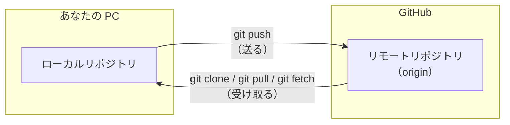

# 第 3 章: GitHub とリモートリポジトリ

第 2 章では、自分の PC の中だけでコミットを記録しました。
この章では、そのリポジトリを GitHub にアップロードし、ほかの PC や他の人と共有する方法を学びます。

## この章のゴール

- [ ] ローカルリポジトリとリモートリポジトリの違いを説明できる
- [ ] GitHub にリポジトリを作り、`git push` でコミットを送れる
- [ ] `git clone` でリポジトリを複製できる
- [ ] `git pull` / `git fetch` でリモートの変更を取り込める
- [ ] push が拒否されたときに、落ち着いて対処できる

**所要時間の目安:** 60〜90 分

## 3.1 リモートリポジトリとは

自分の PC の中にあるリポジトリを **ローカルリポジトリ**、GitHub などのサーバー上にあるリポジトリを **リモートリポジトリ** と呼びます。



| コマンド | 動作 |
| --- | --- |
| `git clone` | リモートリポジトリを、履歴ごと丸ごと手元に複製する（最初の 1 回） |
| `git push` | ローカルのコミットをリモートに送る |
| `git fetch` | リモートの新しいコミットを受け取る（作業中のファイルは変えない） |
| `git pull` | リモートの新しいコミットを受け取り、作業中のブランチに取り込む（`fetch` + `merge`） |

リモートリポジトリには名前を付けて管理します。clone したときの接続先には、慣習的に **`origin`** という名前が付きます。

> [!NOTE]
> Git と GitHub は別物です。**Git** は履歴を管理する「ツール」、**GitHub** は Git のリポジトリを預けて共有するための「Web サービス」です。
> Git は GitHub がなくても使えますし、GitHub の代わりに GitLab や Bitbucket などのサービスを使うこともできます。

## 3.2 GitHub への接続（認証）の仕組み

GitHub に `git push` するには、「あなたがそのリポジトリに書き込んでよい人か」を確認する **認証** が必要です。
接続方法には **HTTPS** と **SSH** の 2 種類があります。

### HTTPS（この教材のおすすめ）

[第 0 章](00-setup.md) で `gh auth login` を実行したとき、「Authenticate Git with your GitHub credentials?」に `Yes` と答えました。
これにより、`git` が GitHub に接続するときに `gh` のログイン情報を使うよう設定されています。追加の作業は必要ありません。

> [!IMPORTANT]
> GitHub では、`git push` のときに **GitHub のパスワードを入力しても認証できません**（2021 年に廃止されました）。
> パスワードを聞かれて先に進めない場合は、`gh auth login` をやり直すか、次のコマンドを実行してください。
>
> ```bash
> gh auth setup-git
> ```

### SSH（参考）

SSH では、PC で作った **鍵のペア**（秘密鍵と公開鍵）のうち、公開鍵を GitHub に登録して認証します。
HTTPS で問題なく使えていれば、設定する必要はありません。

```bash
# 1. 鍵のペアを作る（質問にはすべて Enter で答えてよい。パスフレーズは設定を推奨）
ssh-keygen -t ed25519 -C "<メールアドレス>"

# 2. 公開鍵（.pub の方）を GitHub に登録する
gh ssh-key add ~/.ssh/id_ed25519.pub --title "my-laptop"

# 3. 接続を確認する
ssh -T git@github.com
```

`Hi <ユーザー名>! You've successfully authenticated...` と表示されれば成功です。

手順 2 で権限（scope）が足りないというエラーが出た場合は、次のコマンドで `gh` に鍵を登録する権限を追加してから、もう一度実行してください。

```bash
gh auth refresh -h github.com -s admin:public_key
```

> [!WARNING]
> `~/.ssh/id_ed25519`（`.pub` が付いていない方）は **秘密鍵** です。他人に渡したり、GitHub に登録したりしてはいけません。

## 3.3 GitHub にリポジトリを作って push する

第 2 章で作った `~/git-practice/my-first-repo` を GitHub にアップロードします。
ブラウザで操作する方法と、`gh` コマンドを使う方法があります。**どちらか一方** を実行してください。

### 方法 1: ブラウザで作る

1. GitHub の右上の「**+**」→「**New repository**」をクリックします。
2. 次のように入力します。
   - **Repository name**: `my-first-repo`
   - **Visibility**: `Private`（自分と招待した人だけが見られる）
   - **Add README** や **.gitignore**、**license** は **すべてオフ** のままにします（手元にすでにリポジトリがあるため）
3. 「**Create repository**」をクリックします。
4. 表示された画面の「**…or push an existing repository from the command line**」に書かれたコマンドを、ターミナルで実行します。

```bash
cd ~/git-practice/my-first-repo
git remote add origin https://github.com/<あなたのユーザー名>/my-first-repo.git
git branch -M main
git push -u origin main
```

| コマンド | 意味 |
| --- | --- |
| `git remote add origin <URL>` | `<URL>` のリモートリポジトリを `origin` という名前で登録する |
| `git branch -M main` | 今のブランチの名前を `main` にする（すでに `main` なら何も変わらない） |
| `git push -u origin main` | `main` ブランチを `origin` に送る。`-u` は「今後このブランチは `origin` の `main` と対応させる」という設定で、次からは `git push` だけで送れるようになる |

### 方法 2: gh コマンドで作る

```bash
cd ~/git-practice/my-first-repo
gh repo create my-first-repo --private --source=. --remote=origin --push
```

| オプション | 意味 |
| --- | --- |
| `--private` | 非公開のリポジトリにする（公開する場合は `--public`） |
| `--source=.` | 今いるディレクトリのリポジトリを元にする |
| `--remote=origin` | リモートを `origin` という名前で登録する |
| `--push` | 作成後すぐに push する |

出力例:

```text
✓ Created repository hanako/my-first-repo on github.com
  https://github.com/hanako/my-first-repo
✓ Added remote https://github.com/hanako/my-first-repo.git
✓ Pushed commits to https://github.com/hanako/my-first-repo.git
```

### 確認する

ブラウザで GitHub のリポジトリのページを開きます。`gh` を使うと、ターミナルから開けます。

```bash
gh browse
```

`README.md` の内容がページの下部に表示され、「**commits**」のリンクからコミットの履歴を確認できます。

登録されているリモートリポジトリは、次のコマンドで確認できます。

```bash
git remote -v
```

```text
origin  https://github.com/hanako/my-first-repo.git (fetch)
origin  https://github.com/hanako/my-first-repo.git (push)
```

## 3.4 変更を push する

2 回目以降は、「編集 → `git add` → `git commit` → `git push`」の流れになります。

```bash
echo "- GitHub に push できた" >> README.md
git add README.md
git commit -m "README に進捗を追記"
git push
```

`git status` を実行すると、ローカルとリモートの差も教えてくれます。

```text
$ git status
On branch main
Your branch is ahead of 'origin/main' by 1 commit.
  (use "git push" to publish your local commits)
```

`ahead of 'origin/main' by 1 commit` は「リモートよりローカルの方が 1 コミット進んでいる（まだ push していない）」という意味です。

> [!WARNING]
> 一度 push したコミットは、他の人が取り込んでいる可能性があります。push した後に履歴を書き換える操作（`git commit --amend`、`git reset`、`git push --force` など）は避けましょう。
> 間違えて push した場合の対処は [第 8 章](08-troubleshooting.md) を参照してください。

## 3.5 リポジトリを複製する（git clone）

別の PC で作業するときや、他の人のリポジトリで作業するときは `git clone` を使います。
ここでは、同じ PC の別の場所に clone して「もう 1 台の PC」の代わりにしてみましょう。

```bash
cd ~/git-practice
git clone https://github.com/<あなたのユーザー名>/my-first-repo.git my-first-repo-2
```

最後の `my-first-repo-2` は clone 先のディレクトリ名です（省略するとリポジトリ名になります）。
`gh` を使う場合は、次のように `<ユーザー名>/<リポジトリ名>` だけで指定できます。

```bash
gh repo clone <あなたのユーザー名>/my-first-repo my-first-repo-2
```

clone したリポジトリには、最初から `origin` が登録されています。

## 3.6 リモートの変更を取り込む（git pull / git fetch）

### GitHub 上でファイルを編集する

1. ブラウザで `my-first-repo` のページを開き、`README.md` をクリックします。
2. 右上の鉛筆アイコン（Edit this file）をクリックします。
3. 1 行追記して、「**Commit changes...**」→「**Commit changes**」をクリックします。

これで、リモートリポジトリにだけ新しいコミットがある状態になりました。

### git pull で取り込む

```bash
cd ~/git-practice/my-first-repo
git pull
```

```text
From https://github.com/hanako/my-first-repo
   1d5c482..8e4f2a1  main       -> origin/main
Updating 1d5c482..8e4f2a1
Fast-forward
 README.md | 1 +
 1 file changed, 1 insertion(+)
```

`cat README.md` で、GitHub で追記した行が反映されていることを確認しましょう。

### git fetch で確認してから取り込む

`git pull` は「受け取る（fetch）」と「取り込む（merge）」を一度に行います。
取り込む前に何が変わったのかを確認したい場合は、2 段階に分けて実行します。

```bash
git fetch                      # リモートの変更を受け取る（作業中のファイルは変わらない）
git log --oneline main..origin/main   # リモートにだけあるコミットを表示する
git diff main origin/main      # 差分を確認する
git merge origin/main          # 取り込む
```

`origin/main` は **リモート追跡ブランチ** と呼ばれ、「最後に fetch したときのリモートの main の状態」を表します。

> [!TIP]
> **作業を始める前に `git pull`** する習慣を付けましょう。古い状態のまま作業を進めると、後で他の人の変更とぶつかりやすくなります。

## 3.7 push が拒否されたら

他の人（または別の PC の自分）が先に push していると、あなたの push は拒否されます。

```text
$ git push
To https://github.com/hanako/my-first-repo.git
 ! [rejected]        main -> main (fetch first)
error: failed to push some refs to 'https://github.com/hanako/my-first-repo.git'
hint: Updates were rejected because the remote contains work that you do not
hint: have locally. This is usually caused by another repository pushing to
hint: the same ref. If you want to integrate the remote changes, use
hint: 'git pull' before pushing again.
hint: See the 'Note about fast-forwards' in 'git push --help' for details.
```

「リモートに、あなたの手元にないコミットがある」という意味です。慌てずに、**先に `git pull` でリモートの変更を取り込んでから**、もう一度 `git push` します。

```bash
git pull
git push
```

`git pull` のときにエディタが開いたら、それは自動で作られる **マージコミット** のメッセージを編集する画面です。そのまま保存して閉じれば OK です（nano なら <kbd>Ctrl</kbd> + <kbd>X</kbd>、vim なら <kbd>Esc</kbd> → `:wq`）。

> [!CAUTION]
> エラーを消すために `git push --force` を使ってはいけません。リモートにある **他の人のコミットを消してしまいます**。

両方が同じ行を変更していた場合は **コンフリクト（競合）** が発生します。解消方法は [第 4 章](04-branch.md) で学びます。

## 3.8 GitHub のリポジトリ画面の見方

| タブ | 内容 |
| --- | --- |
| **Code** | ファイルの一覧と `README.md` の内容。ブランチの切り替えやコミット履歴の確認もここから |
| **Issues** | やること・バグ・要望などを管理する（[第 5 章](05-issue.md)） |
| **Pull requests** | 変更の提案とレビュー（[第 6 章](06-pull-request.md)） |
| **Actions** | テストなどの自動実行（CI）の結果 |
| **Settings** | リポジトリの設定（公開範囲、メンバーの招待、ブランチの保護など） |

> [!NOTE]
> **フォーク（Fork）** は、他の人のリポジトリを自分のアカウントにコピーする機能です。オープンソースのプロジェクトに貢献するときによく使います。
> この教材では、フォークの代わりに自分のアカウントで新しくリポジトリを作って練習します。

## 演習

### 演習 3-1: GitHub に push する

本文の [3.3](#33-github-にリポジトリを作って-push-する) と [3.4](#34-変更を-push-する) の手順で、`my-first-repo` を GitHub に push し、ブラウザでコミット履歴を確認してください。

### 演習 3-2: 2 つの clone を行き来する

1. 本文の [3.5](#35-リポジトリを複製するgit-clone) の手順で、`my-first-repo-2` に clone してください。
2. `my-first-repo-2` で `profile.md` を編集してコミットし、push してください。
3. `my-first-repo` で `git pull` して、変更が反映されることを確認してください。

<details>
<summary>解答例</summary>

```bash
cd ~/git-practice/my-first-repo-2
echo "- 特技: タイピング" >> profile.md
git add profile.md
git commit -m "自己紹介に特技を追加"
git push

cd ~/git-practice/my-first-repo
git pull
cat profile.md
```

</details>

### 演習 3-3: push が拒否される状況を体験する

GitHub の代わりに PC の中に「リモートリポジトリ」を作り、Alice さんと Bob さんの 2 人で開発する状況を再現します。

```bash
cd ~
bash ~/github-and-cli-tutorials/exercises/scripts/make-team-sandbox.sh
```

1. `~/team-sandbox/alice` で `README.md` の「（未定）」を好きな目標に書き換えて、コミットして push してください。
2. `~/team-sandbox/bob` で新しいファイル `bob.txt` を作ってコミットし、push してください。拒否されることを確認します。
3. `bob` で `git pull` してから、もう一度 push してください。
4. `alice` で `git pull` して、Bob さんの `bob.txt` が取り込まれたことを確認してください。
5. `git log --oneline --graph` で履歴の形を確認してください。

<details>
<summary>解答例</summary>

```bash
cd ~/team-sandbox/alice
nano README.md                      # 「（未定）」を書き換える
git commit -am "今週の目標を追加"    # -a: 変更済みのファイルを自動で add する
git push

cd ~/team-sandbox/bob
echo "Bob です。よろしくお願いします。" > bob.txt
git add bob.txt
git commit -m "Bob の自己紹介を追加"
git push                            # 拒否される
git pull                            # エディタが開いたら、そのまま保存して閉じる
git push                            # 成功する

cd ~/team-sandbox/alice
git pull
ls                                  # bob.txt がある
git log --oneline --graph
```

`git log --oneline --graph` の結果は、次のような形になります。2 人の作業が枝分かれし、マージコミットで合流しています。

```text
*   38731b1 Merge branch 'main' of /home/hanako/team-sandbox/remote
|\
| * c9afb52 今週の目標を追加
* | 03cb570 Bob の自己紹介を追加
|/
* 555c667 README を追加
```

</details>

## まとめ

- GitHub 上のリポジトリを **リモートリポジトリ**（通常は `origin`）と呼ぶ
- `git push` で送り、`git pull` で受け取る。最初の 1 回は `git clone`
- 作業を始める前に `git pull` する
- push が拒否されたら `git pull` してから push し直す。`--force` は使わない

---

[← 前の章: Git の基本](02-git-basics.md) ｜ [目次](../README.md) ｜ [次の章: ブランチ →](04-branch.md)
