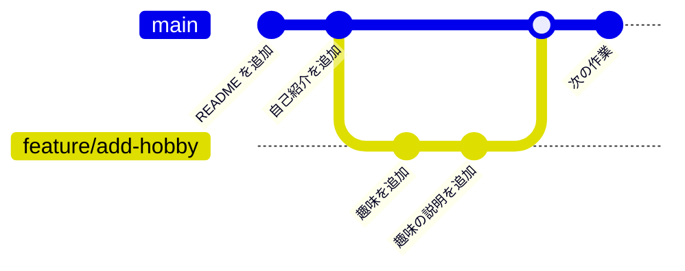
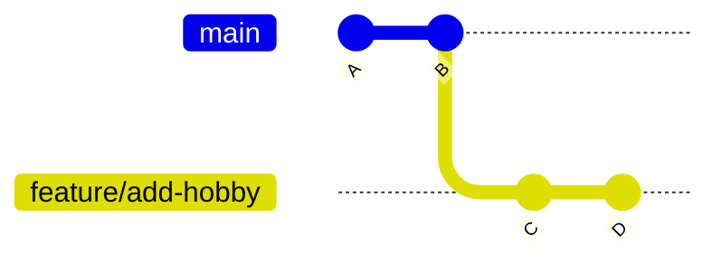
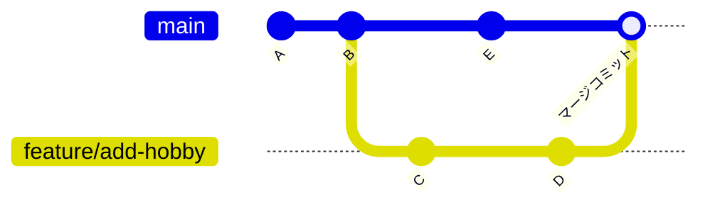

# 第 4 章: ブランチ

**ブランチ** を使うと、メインの流れに影響を与えずに、新しい機能の開発やバグ修正を並行して進められます。
チーム開発では「作業ごとにブランチを作り、完成したらメインのブランチにまとめる（マージする）」のが基本です。

## この章のゴール

- [ ] ブランチを作り、切り替えられる
- [ ] ブランチをマージできる
- [ ] fast-forward マージとマージコミットの違いを説明できる
- [ ] コンフリクトを解消できる
- [ ] ブランチを GitHub に push し、不要になったら削除できる

**所要時間の目安:** 60〜90 分

## 4.1 ブランチとは

ブランチは、コミットの流れを枝分かれさせる仕組みです。



- **`main`** は、プロジェクトの「本流」のブランチです。いつでも正しく動く状態を保ちます。
- **`feature/add-hobby`** のような作業用のブランチを作り、その上でコミットを重ねます。作業中のコミットは `main` に影響しません。
- 作業が完成したら、`main` に **マージ**（合流）します。

ブランチの実体は「特定のコミットを指す名札」のようなものです。コミットすると、名札が新しいコミットに移動します。
そして **`HEAD`** は「今自分がいるブランチ」を指す特別な名札です。

## 4.2 ブランチを作って切り替える

[第 2 章](02-git-basics.md) と [第 3 章](03-github-remote.md) で使った `my-first-repo` で試してみましょう。

```bash
cd ~/git-practice/my-first-repo
git pull                         # 作業の前に最新の状態にする
```

### ブランチの一覧を表示する

```bash
git branch
```

```text
* main
```

`*` が付いているのが、今いるブランチです。

### ブランチを作って切り替える

```bash
git switch -c feature/add-hobby
```

```text
Switched to a new branch 'feature/add-hobby'
```

`-c`（create）を付けると、ブランチを作ってすぐに切り替えます。既存のブランチに切り替えるときは `-c` を付けません。

```bash
git switch main                  # main に切り替える
git switch feature/add-hobby     # feature/add-hobby に切り替える
```

> [!NOTE]
> 古い解説記事では `git checkout -b <ブランチ名>`（作って切り替える）や `git checkout <ブランチ名>`（切り替える）が使われています。
> `git switch` は、ブランチの切り替え専用に Git 2.23 で追加された新しいコマンドで、意味は同じです。

### ブランチ上でコミットする

```bash
echo "- 趣味: 読書" >> README.md
git commit -am "趣味を追加"
git branch
```

```text
* feature/add-hobby
  main
```

`main` に切り替えて `README.md` を確認すると、今追加した行は **ありません**。ブランチごとに別々の状態を持っていることが分かります。

```bash
git switch main
cat README.md                    # 「趣味」の行がない
git switch feature/add-hobby
cat README.md                    # 「趣味」の行がある
```

> [!TIP]
> コミットしていない変更がある状態でブランチを切り替えると、その変更は切り替え先にも持ち越されます。
> 切り替え先のブランチと衝突する場合は、Git が切り替えを止めて教えてくれます。
> ブランチを切り替える前には、`git status` で変更が残っていないか確認する習慣を付けましょう（一時的に退避する方法は [第 8 章](08-troubleshooting.md) で紹介します）。

## 4.3 ブランチの名前の付け方

ブランチ名は、チームで決めたルールに従うのが基本です。よく使われるのは「種類/内容」の形です。

| 接頭辞 | 用途 | 例 |
| --- | --- | --- |
| `feature/` | 新しい機能の追加 | `feature/add-delete-command` |
| `fix/` | バグの修正 | `fix/empty-task` |
| `docs/` | ドキュメントの修正 | `docs/update-readme` |
| `refactor/` | 動作を変えないコードの整理 | `refactor/split-functions` |

- 英小文字・数字・ハイフン（`-`）を使い、スペースや日本語は避けます。
- Issue の番号を入れると、どの作業のブランチなのかが分かりやすくなります（例: `fix/3-empty-task`）。

## 4.4 マージする

作業用のブランチの変更を `main` に取り込むには、**取り込む側**（`main`）に切り替えてから `git merge` を実行します。

```bash
git switch main
git merge feature/add-hobby
```

```text
Updating 1d5c482..69a2a21
Fast-forward
 README.md | 1 +
 1 file changed, 1 insertion(+)
```

### fast-forward マージ

上の例では `Fast-forward` と表示されました。
`main` にブランチを作った後の新しいコミットがない場合、Git は `main` の名札を前に進めるだけでマージを完了します。これを **fast-forward（早送り）マージ** と呼びます。



↑ マージ前: `main` は B、`feature/add-hobby` は D を指している。
マージ後は `main` も D を指すようになるだけで、新しいコミットは作られません。

### マージコミット

ブランチを作った後に `main` にも新しいコミットがある場合は、両方の変更をまとめた **マージコミット** が新しく作られます。



このときは、マージコミットのメッセージを編集するエディタが開きます。通常は `Merge branch 'feature/add-hobby'` のままで問題ないので、保存して閉じてください。

### 不要になったブランチを削除する

マージが終わったブランチは削除して構いません。コミットは `main` に取り込まれているので消えません。

```bash
git branch -d feature/add-hobby
```

```text
Deleted branch feature/add-hobby (was 69a2a21).
```

まだマージしていないブランチを `-d` で削除しようとすると、Git がエラーで止めてくれます。
本当に不要な（マージせずに捨てる）ブランチは `-D` で強制的に削除できます。

## 4.5 コンフリクト（競合）を解消する

2 つのブランチで **同じファイルの同じ箇所** を別々に変更していると、Git はどちらを採用すればよいか判断できません。
これを **コンフリクト（競合）** と呼びます。コンフリクトは失敗ではなく、「人間が判断してください」という Git からの依頼です。

### コンフリクトを起こしてみる

練習用のリポジトリを作るスクリプトを用意しています。

```bash
cd ~
bash ~/github-and-cli-tutorials/exercises/scripts/make-conflict-sandbox.sh
cd ~/conflict-sandbox
git log --oneline --graph --all
```

```text
* a3766d4 (feature/update-hobby) 趣味を料理に変更
| * 2b7f86e (HEAD -> main) 趣味を読書に変更
|/
* 6bec1e0 プロフィールを追加
```

`main` では「趣味」を「読書」に、`feature/update-hobby` では「料理」に変更しています。マージしてみましょう。

```bash
git merge feature/update-hobby
```

```text
Auto-merging profile.txt
CONFLICT (content): Merge conflict in profile.txt
Automatic merge failed; fix conflicts and then commit the result.
```

### 手順 1: どのファイルでコンフリクトしたか確認する

```bash
git status
```

```text
On branch main
You have unmerged paths.
  (fix conflicts and run "git commit")
  (use "git merge --abort" to abort the merge)

Unmerged paths:
  (use "git add <file>..." to mark resolution)
	both modified:   profile.txt
```

`both modified`（両方で変更された）と表示されているファイルが、コンフリクトしたファイルです。

### 手順 2: ファイルを編集して解消する

コンフリクトしたファイルを開くと、Git が **コンフリクトマーカー** を書き込んでいます。

```text
名前: 山田 花子
出身: 東京都
<<<<<<< HEAD
趣味: 読書
=======
趣味: 料理
>>>>>>> feature/update-hobby
好きな食べ物: カレー
```

| マーカー | 意味 |
| --- | --- |
| `<<<<<<< HEAD` 〜 `=======` | 今いるブランチ（`main`）の内容 |
| `=======` 〜 `>>>>>>> feature/update-hobby` | マージしようとしているブランチの内容 |

エディタで、**最終的にあるべき内容** に書き換えます。片方を採用しても、両方を組み合わせても構いません。
**マーカーの行（`<<<<<<<`、`=======`、`>>>>>>>`）は必ず削除** します。

```text
名前: 山田 花子
出身: 東京都
趣味: 読書と料理
好きな食べ物: カレー
```

> [!TIP]
> VS Code でコンフリクトしたファイルを開くと、マーカーの上に「Accept Current Change（今のブランチを採用）」「Accept Incoming Change（取り込む側を採用）」「Accept Both Changes（両方を採用）」というボタンが表示され、クリックで解消できます。

### 手順 3: 解消したファイルを add してコミットする

```bash
git add profile.txt
git status
```

```text
On branch main
All conflicts fixed but you are still merging.
  (use "git commit" to conclude merge)

Changes to be committed:
	modified:   profile.txt
```

```bash
git commit
```

エディタが開き、`Merge branch 'feature/update-hobby'` というメッセージが入力済みになっています。そのまま保存して閉じれば、マージ完了です。

```bash
git log --oneline --graph
```

```text
*   30037e3 (HEAD -> main) Merge branch 'feature/update-hobby'
|\
| * a3766d4 (feature/update-hobby) 趣味を料理に変更
* | 2b7f86e 趣味を読書に変更
|/
* 6bec1e0 プロフィールを追加
```

### マージをやめたいとき

コンフリクトの解消中に「やっぱりマージをやめて元に戻したい」と思ったら、次のコマンドでマージ前の状態に戻せます。

```bash
git merge --abort
```

## 4.6 ブランチを GitHub に push する

ブランチは、`main` と同じように GitHub に push できます。チームの他のメンバーに見せたり、Pull Request（[第 6 章](06-pull-request.md)）を作ったりするために使います。

```bash
cd ~/git-practice/my-first-repo
git switch -c docs/add-goal
echo "- 目標: GitHub を使いこなす" >> README.md
git commit -am "目標を追加"
git push -u origin docs/add-goal
```

初めて push するブランチには `-u origin <ブランチ名>` を付けます。2 回目以降は `git push` だけで送れます。

GitHub のリポジトリページで、ブランチの切り替えメニュー（`main` と表示されているボタン）から `docs/add-goal` を選ぶと、push したブランチの内容を確認できます。

### リモートのブランチを確認する・取り込む

```bash
git fetch                 # リモートの最新の情報を取得する
git branch -a             # ローカルとリモートのブランチをすべて表示する
```

```text
* docs/add-goal
  main
  remotes/origin/docs/add-goal
  remotes/origin/main
```

他の人が push したブランチ（例: `origin/feature/xxx`）で作業したいときは、`git switch feature/xxx` を実行すると、同じ名前のローカルブランチが自動で作られます。

### リモートのブランチを削除する

```bash
git push origin --delete docs/add-goal   # GitHub 上のブランチを削除する
git fetch --prune                        # 削除済みのリモートブランチの情報を手元からも消す
```

ふだんは、Pull Request をマージしたときに GitHub の画面でブランチを削除するのが一般的です（[第 6 章](06-pull-request.md)）。

## 4.7 なぜ main に直接コミットしないのか

ここまでの例では、作業ブランチを手元で `main` にマージしました。
しかしチーム開発では、**手元でマージして `main` に push するのではなく、Pull Request を作って GitHub 上でマージする** のが一般的です。

- マージする前に、他のメンバーが変更内容を **レビュー** できる
- マージする前に、テストを **自動で実行** して問題がないか確認できる
- 「なぜこの変更をしたのか」という議論が記録に残る

この流れは [第 5 章](05-issue.md)〜[第 7 章](07-github-flow.md) で練習します。

## 演習

### 演習 4-1: fast-forward マージ

`my-first-repo` で `feature/add-food` ブランチを作り、`profile.md` に好きな食べ物を 2 つ追加してください（1 つずつ、2 回コミットします）。
その後 `main` にマージし、ブランチを削除してください。

<details>
<summary>解答例</summary>

```bash
cd ~/git-practice/my-first-repo
git switch main
git switch -c feature/add-food
echo "- 好きな食べ物 1: カレー" >> profile.md
git commit -am "好きな食べ物を追加"
echo "- 好きな食べ物 2: ラーメン" >> profile.md
git commit -am "好きな食べ物をもう 1 つ追加"

git switch main
git merge feature/add-food          # Fast-forward と表示される
git branch -d feature/add-food
git log --oneline --graph
git push                            # GitHub にも反映する
```

</details>

### 演習 4-2: コンフリクトを解消する

本文の [4.5](#45-コンフリクト競合を解消する) の手順で、`~/conflict-sandbox` のコンフリクトを解消してください。
もう一度最初から練習したいときは、`rm -rf ~/conflict-sandbox` で削除してからスクリプトを実行し直します。

### 演習 4-3: チーム開発でのコンフリクト

[第 3 章の演習 3-3](03-github-remote.md#演習-3-3-push-が拒否される状況を体験する) で作った `~/team-sandbox` を使います。

1. `alice` と `bob` の両方で、最初に `git pull` して最新の状態にしてください。
2. `alice` で、`README.md` の `- Alice` の行を `- Alice（リーダー）` に書き換えて、コミットして push してください。
3. `bob` で、`README.md` の `- Alice` の行のすぐ下に `- Bob` という行を追加して、コミットして push してください（拒否されます）。
4. `bob` で `git pull` するとコンフリクトが発生します。解消して push してください。

<details>
<summary>解答例</summary>

```bash
cd ~/team-sandbox/alice && git pull
cd ~/team-sandbox/bob && git pull

cd ~/team-sandbox/alice
nano README.md                 # 「- Alice」を「- Alice（リーダー）」に書き換える
git commit -am "Alice をリーダーにする"
git push

cd ~/team-sandbox/bob
nano README.md                 # 「- Alice」の下に「- Bob」を追加する
git commit -am "メンバーに Bob を追加"
git push                       # 拒否される
git pull                       # CONFLICT と表示される
git status                     # both modified: README.md
nano README.md                 # マーカーを消して「- Alice（リーダー）」「- Bob」の 2 行にする
git add README.md
git commit                     # エディタが開いたら、そのまま保存して閉じる
git push
```

</details>

> [!TIP]
> 練習環境を作り直したいときは、`rm -rf ~/team-sandbox` で削除してから `make-team-sandbox.sh` を実行し直してください。

## まとめ

- `git switch -c <名前>` でブランチを作って切り替え、`git switch <名前>` で切り替える
- 取り込む側のブランチに移動してから `git merge <ブランチ>` でマージする
- コンフリクトしたら「`git status` で確認 → ファイルを編集してマーカーを消す → `git add` → `git commit`」
- 迷ったら `git merge --abort` でマージ前に戻れる
- チーム開発では、ブランチを push して Pull Request でマージする

---

[← 前の章: GitHub とリモートリポジトリ](03-github-remote.md) ｜ [目次](../README.md) ｜ [次の章: Issue →](05-issue.md)
