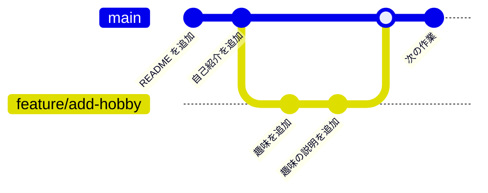
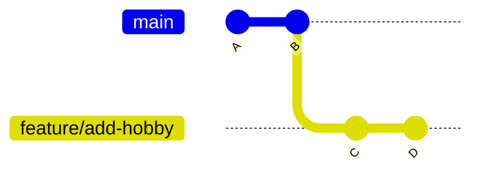
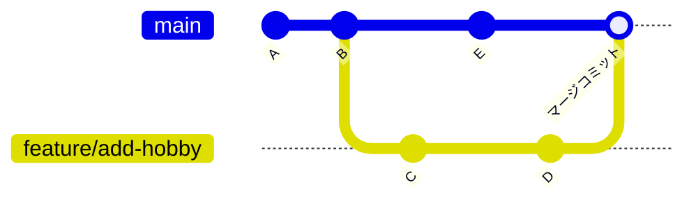

# 第 4 章: ブランチ

**ブランチ** を使うと、メインの流れに影響を与えずに、新しい機能の開発やバグ修正を並行して進められます。
チーム開発では「作業ごとにブランチを作り、完成したらメインのブランチにまとめる（マージする）」のが基本です。

## この章のゴール

- [ ] ブランチを作り、切り替えられる
- [ ] ブランチをマージできる
- [ ] fast-forward マージとマージコミットの違いを説明できる
- [ ] コンフリクトを解消できる
- [ ] ブランチを GitHub に push し、不要になったら削除できる

**所要時間の目安:** 60〜90 分

## 4.1 ブランチとは

ブランチは、コミットの流れを枝分かれさせる仕組みです。



- **`main`** は、プロジェクトの「本流」のブランチです。いつでも正しく動く状態を保ちます。
- **`feature/add-hobby`** のような作業用のブランチを作り、その上でコミットを重ねます。作業中のコミットは `main` に影響しません。
- 作業が完成したら、`main` に **マージ**（合流）します。

ブランチの実体は「特定のコミットを指す名札」のようなものです。コミットすると、名札が新しいコミットに移動します。
そして **`HEAD`** は「今自分がいるブランチ」を指す特別な名札です。
VS Code では、画面の左下の **ステータス バー**（Status Bar）に、今いるブランチの名前が表示されます（[公式ドキュメント: Branches and worktrees](https://code.visualstudio.com/docs/sourcecontrol/branches-worktrees)）。

## 4.2 ブランチを作って切り替える

[第 2 章](02-git-basics.md) と [第 3 章](03-github-remote.md) で使った `my-first-repo` で試してみましょう。
VS Code で `~/git-practice/my-first-repo` を開き、作業の前に最新の状態にしておきます。**ソース管理**（Source Control）ビューの **…**（**その他の操作...**（More Actions...））> **プル**（Pull）を選ぶか、統合ターミナルで次のコマンドを実行します。

```bash
cd ~/git-practice/my-first-repo
git pull                         # 作業の前に最新の状態にする
```

### ブランチの一覧を表示する

#### VS Code で操作する

- ステータス バーの左下に、今いるブランチの名前（`main`）が表示されています。
- ブランチ名をクリックすると、画面の上部にブランチの一覧が表示されます。確認したら、何も選ばずに <kbd>Esc</kbd> で閉じます。
- **ソース管理** ビューの **グラフ**（Graph）では、コミットの右側に、そのコミットを指すブランチのラベルが表示されます。最初は今のブランチと、その push 先（`origin/main`）だけが表示されます。

すべてのブランチをグラフに表示するには、次のように切り替えます（[公式ドキュメント: Source Control Graph](https://code.visualstudio.com/docs/sourcecontrol/history)）。

1. **グラフ** の見出しの右側にある、ブランチのアイコンと **自動**（Auto）と書かれたボタンをクリックします（見当たらないときは、見出しにマウス ポインターを合わせると表示されます）。
2. 一覧の **すべて**（All）にチェックを入れ、<kbd>Enter</kbd> を押します。

#### コマンドで操作する

```bash
git branch
```

```text
* main
```

`*` が付いているのが、今いるブランチです。

### ブランチを作って切り替える

#### VS Code で操作する

1. ステータス バーのブランチ名（`main`）をクリックします。
2. 一覧の一番上の「**+ 新しいブランチの作成...**」（Create new branch...）を選びます。
3. 「新しいブランチ名を入力してください」と表示されるので、`feature/add-hobby` と入力して <kbd>Enter</kbd> を押します。
4. ブランチが作られて切り替わり、ステータス バーの表示が `feature/add-hobby` に変わります。

コマンド パレット（<kbd>Ctrl</kbd> + <kbd>Shift</kbd> + <kbd>P</kbd>（macOS は <kbd>Command</kbd> + <kbd>Shift</kbd> + <kbd>P</kbd>））で「**Git: ブランチの作成...**」（Git: Create Branch...）を実行しても、同じようにブランチを作れます。

既存のブランチに切り替えるときは、ステータス バーのブランチ名をクリックし、一覧から切り替え先のブランチを選びます。コマンド パレットの「**Git: チェックアウト先...**」（Git: Checkout to...）でも、同じ一覧が開きます。

VS Code は、ブランチを作るときや切り替えるときに、内部で `git checkout` というコマンド（`git switch` より前からあるコマンド）を実行しています。ここでの効果は `git switch` と同じなので、気にしなくて構いません。

#### コマンドで操作する

```bash
git switch -c feature/add-hobby
```

```text
Switched to a new branch 'feature/add-hobby'
```

`-c`（create）を付けると、ブランチを作ってすぐに切り替えます。既存のブランチに切り替えるときは `-c` を付けません。

```bash
git switch main                  # main に切り替える
git switch feature/add-hobby     # feature/add-hobby に切り替える
```

> [!NOTE]
> 古い解説記事では `git checkout -b <ブランチ名>`（作って切り替える）や `git checkout <ブランチ名>`（切り替える）が使われています。
> `git switch` は、ブランチの切り替え専用に Git 2.23 で追加された新しいコマンドで、意味は同じです。

### ブランチ上でコミットする

#### VS Code で操作する

1. ステータス バーが `feature/add-hobby` になっていることを確認します。
2. `README.md` を開き、最後に `- 趣味: 読書` という行を追加して保存します。
3. **ソース管理** ビューで **+**（**変更をステージ**（Stage Changes））をクリックし、メッセージ `趣味を追加` で **コミット**（Commit）します。メッセージ欄には「メッセージ (Ctrl+Enter で "feature/add-hobby" にコミット)」のように、コミット先のブランチ名が表示されています。
4. コミットすると **Branch の発行**（Publish Branch）ボタンが表示されますが、ここでは GitHub に送らないので、クリックしなくて構いません（ブランチの push は [4.6](#46-ブランチを-github-に-push-する) で行います）。
5. ステータス バーのブランチ名をクリックして `main` に切り替えます。開いている `README.md` から、今追加した行が消えます。もう一度 `feature/add-hobby` に切り替えると、行が戻ります。

#### コマンドで操作する

```bash
echo "- 趣味: 読書" >> README.md
git commit -am "趣味を追加"
git branch
```

```text
* feature/add-hobby
  main
```

`main` に切り替えて `README.md` を確認すると、今追加した行は **ありません**。ブランチごとに別々の状態を持っていることが分かります。

```bash
git switch main
cat README.md                    # 「趣味」の行がない
git switch feature/add-hobby
cat README.md                    # 「趣味」の行がある
```

> [!TIP]
> コミットしていない変更がある状態でブランチを切り替えると、その変更は切り替え先にも持ち越されます。
> 切り替え先のブランチと衝突する場合は、Git が切り替えを止めて教えてくれます。VS Code では「ローカルの変更は、チェックアウトによって上書きされます。」というダイアログが表示されます。ボタンの意味が分かるまでは、どれも選ばずに閉じてください（**チェックアウトの強制**（Force Checkout）を選ぶと、コミットしていない変更が消えてしまいます）。
> ブランチを切り替える前には、ソース管理ビューや `git status` で変更が残っていないか確認する習慣を付けましょう（一時的に退避する方法は [第 8 章](08-troubleshooting.md) で紹介します）。

## 4.3 ブランチの名前の付け方

ブランチ名は、チームで決めたルールに従うのが基本です。よく使われるのは「種類/内容」の形です。

| 接頭辞 | 用途 | 例 |
| --- | --- | --- |
| `feature/` | 新しい機能の追加 | `feature/add-delete-command` |
| `fix/` | バグの修正 | `fix/empty-task` |
| `docs/` | ドキュメントの修正 | `docs/update-readme` |
| `refactor/` | 動作を変えないコードの整理 | `refactor/split-functions` |

- 英小文字・数字・ハイフン（`-`）を使い、スペースや日本語は避けます。
- Issue の番号を入れると、どの作業のブランチなのかが分かりやすくなります（例: `fix/3-empty-task`）。

## 4.4 マージする

作業用のブランチの変更を `main` に取り込むには、**取り込む側**（`main`）に切り替えてからマージします。

### VS Code で操作する

1. ステータス バーのブランチ名をクリックし、`main` に切り替えます。
2. コマンド パレットで「**Git: マージ...**」（Git: Merge...）を実行します。**ソース管理**（Source Control）ビューの **…** > **ブランチ**（Branch）> **マージ...** でも同じです。
3. 「マージ元のブランチまたはタグを選択する」と表示されるので、`feature/add-hobby` を選びます。
4. **グラフ**（Graph）で結果を確認します。この例ではマージコミットは作られず、`main` のラベルが「趣味を追加」のコミットに移ります。まだ push していないコミットがあるので、一番上に **送信した変更点**（Outgoing Changes）という項目も表示されます。

### コマンドで操作する

```bash
git switch main
git merge feature/add-hobby
```

```text
Updating 1d5c482..69a2a21
Fast-forward
 README.md | 1 +
 1 file changed, 1 insertion(+)
```

### fast-forward マージ

コマンドで実行した上の例では、`Fast-forward` と表示されました（VS Code でマージしたときは、何も表示されずに終わります）。
`main` にブランチを作った後の新しいコミットがない場合、Git は `main` の名札を前に進めるだけでマージを完了します。これを **fast-forward（早送り）マージ** と呼びます。



↑ マージ前: `main` は B、`feature/add-hobby` は D を指している。
マージ後は `main` も D を指すようになるだけで、新しいコミットは作られません。

### マージコミット

ブランチを作った後に `main` にも新しいコミットがある場合は、両方の変更をまとめた **マージコミット** が新しく作られます。



マージコミットのメッセージは、マージした方法によって次のように決まります。

- **VS Code の「Git: マージ...」でマージしたとき**: エディタは開かず、`Merge branch 'feature/add-hobby'` というメッセージでマージコミットが自動で作られます。VS Code は画面の裏で Git を実行するので、Git はメッセージを編集する画面を出しません。**グラフ** では、2 本の線がこのマージコミットで合流します。
- **ターミナルで `git merge` を実行したとき**: マージコミットのメッセージを編集する VS Code のタブ（`MERGE_MSG`）が開き、ターミナルには `hint: Waiting for your editor to close the file...` と表示されます。通常は `Merge branch 'feature/add-hobby'` のままで問題ないので、保存してからタブを閉じてください（<kbd>Ctrl</kbd> + <kbd>W</kbd>（macOS は <kbd>Command</kbd> + <kbd>W</kbd>））。タブを閉じると、`git merge` の続きが実行されてマージが完了します。

### 不要になったブランチを削除する

マージが終わったブランチは削除して構いません。コミットは `main` に取り込まれているので消えません。

#### VS Code で操作する

1. コマンド パレットで「**Git: ブランチの削除...**」（Git: Delete Branch...）を実行します。**…** > **ブランチ** > **ブランチの削除...** でも同じです。
2. 「削除するブランチの選択」と表示されるので、`feature/add-hobby` を選びます。今いるブランチは一覧に表示されず、削除できません。

#### コマンドで操作する

```bash
git branch -d feature/add-hobby
```

```text
Deleted branch feature/add-hobby (was 69a2a21).
```

まだマージしていないブランチを `-d` で削除しようとすると、Git がエラーで止めてくれます。
VS Code では、「ブランチ 'feature/add-hobby' はマージされていません。それでも削除しますか?」という確認が表示されます。

> [!WARNING]
> 本当に不要な（マージせずに捨てる）ブランチは、コマンドでは `-D` で、VS Code では上の確認で **ブランチの削除**（Delete Branch）を選ぶと、強制的に削除できます。
> そのブランチにしかないコミットは、ブランチと一緒に見えなくなります。消してよいか分からないときは、削除しないでください。

## 4.5 コンフリクト（競合）を解消する

2 つのブランチで **同じファイルの同じ箇所** を別々に変更していると、Git はどちらを採用すればよいか判断できません。
これを **コンフリクト（競合）** と呼びます。コンフリクトは失敗ではなく、「人間が判断してください」という Git からの依頼です。

### コンフリクトを起こしてみる

練習用のリポジトリを作るスクリプトを用意しています。作ったリポジトリは、VS Code で開いておきます。

```bash
cd ~
bash ~/github-and-cli-tutorials/exercises/scripts/make-conflict-sandbox.sh
code ~/conflict-sandbox
```

新しいフォルダなので、VS Code は制限モードで開きます。[0.8](00-setup.md#フォルダを信頼する制限モードを解除する) の手順で信頼してください（信頼しないと、ソース管理ビューが使えません）。この後の操作は、このウィンドウで行います。

このリポジトリでは、`main` で「趣味」を「読書」に、`feature/update-hobby` で「料理」に変更しています。`main` に `feature/update-hobby` をマージしてみましょう。

#### VS Code で操作する

1. **ソース管理**（Source Control）ビューの **グラフ**（Graph）を **すべて**（All）の表示にして（[4.2](#ブランチの一覧を表示する)）、2 つのブランチが枝分かれしていることを確認します。
2. ステータス バーのブランチ名が `main` になっていることを確認し、コマンド パレットで「**Git: マージ...**」（Git: Merge...）を実行して、`feature/update-hobby` を選びます。
3. 右下に「マージの競合があります。変更をコミットする前に解決してください。」という通知が表示されます。

#### コマンドで操作する

```bash
cd ~/conflict-sandbox
git log --oneline --graph --all
```

```text
* a3766d4 (feature/update-hobby) 趣味を料理に変更
| * 2b7f86e (HEAD -> main) 趣味を読書に変更
|/
* 6bec1e0 プロフィールを追加
```

```bash
git merge feature/update-hobby
```

```text
Auto-merging profile.txt
CONFLICT (content): Merge conflict in profile.txt
Automatic merge failed; fix conflicts and then commit the result.
```

### 手順 1: どのファイルでコンフリクトしたか確認する

#### VS Code で操作する

**ソース管理** ビューを開くと、`profile.txt` が **変更のマージ**（Merge Changes）の中に表示されています。
ファイル名の右の `!` は、コンフリクトしていることを表します（エクスプローラーでも、ファイル名の右に `!` が表示されます）。

#### コマンドで操作する

```bash
git status
```

```text
On branch main
You have unmerged paths.
  (fix conflicts and run "git commit")
  (use "git merge --abort" to abort the merge)

Unmerged paths:
  (use "git add <file>..." to mark resolution)
	both modified:   profile.txt
```

`both modified`（両方で変更された）と表示されているファイルが、コンフリクトしたファイルです。

### 手順 2: ファイルを編集して解消する

コンフリクトしたファイルを開くと、Git が **コンフリクトマーカー** を書き込んでいます。

```text
名前: 山田 花子
出身: 東京都
<<<<<<< HEAD
趣味: 読書
=======
趣味: 料理
>>>>>>> feature/update-hobby
好きな食べ物: カレー
```

| マーカー | 意味 | VS Code での呼び方 |
| --- | --- | --- |
| `<<<<<<< HEAD` 〜 `=======` | 今いるブランチ（`main`）の内容。ここでは `趣味: 読書` | **現在の変更**（Current Change） |
| `=======` 〜 `>>>>>>> feature/update-hobby` | マージしようとしているブランチ（`feature/update-hobby`）の内容。ここでは `趣味: 料理` | **入力側の変更**（Incoming Change） |

ファイルを、**最終的にあるべき内容** に書き換えます。片方を採用しても、両方を組み合わせても構いません。
**マーカーの行（`<<<<<<<`、`=======`、`>>>>>>>`）は必ず削除** します。ここでは、次の内容にしてみましょう。

```text
名前: 山田 花子
出身: 東京都
趣味: 読書と料理
好きな食べ物: カレー
```

#### VS Code で操作する

**変更のマージ** の `profile.txt` をクリックして開くと、コンフリクトの部分に色が付き、そのすぐ上に次のボタン（CodeLens）が表示されます（[公式ドキュメント: Merge conflicts](https://code.visualstudio.com/docs/sourcecontrol/merge-conflicts)）。

| ボタン | この例での結果 |
| --- | --- |
| **現在の変更を取り込む**（Accept Current Change） | `main` の `趣味: 読書` だけを残す |
| **入力側の変更を取り込む**（Accept Incoming Change） | `feature/update-hobby` の `趣味: 料理` だけを残す |
| **両方の変更を取り込む**（Accept Both Changes） | `趣味: 読書` と `趣味: 料理` の 2 行を残す |
| **変更の比較**（Compare Changes） | 2 つの内容を左右に並べて比べる（ファイルは変わらない） |

1. **両方の変更を取り込む** をクリックします。マーカーの行が消え、`趣味: 読書` と `趣味: 料理` の 2 行が残ります。
2. 2 行を、`趣味: 読書と料理` の 1 行に書き直して保存します。

片方の内容をそのまま残せばよい場合は、ボタンをクリックするだけで終わりです。どのボタンを使った場合も、最後にファイル全体を見て、マーカーが残っていないことを確認します。

3 つの画面を並べて解消できる **マージ エディター** を使う方法もあります。

1. エディターの右下に表示される **マージ エディターで解決**（Resolve in Merge Editor）をクリックします。
2. マージ エディターが開きます。上の左右に 2 つのブランチの内容、下に保存される内容が表示されます。

   | 場所 | 名前 | 内容 |
   | --- | --- | --- |
   | 左上 | **受信中**（Incoming） | マージしようとしているブランチ（`feature/update-hobby`）の内容 |
   | 右上 | **現在のマシン**（Current） | 今いるブランチ（`main`）の内容 |
   | 下 | **結果**（Result） | 保存される内容 |

3. **受信中** と **現在のマシン** の、コンフリクトの部分にあるチェックボックスで、**結果** に取り込む側を選びます（両方にチェックを入れると、両方の行が入ります）。
4. **結果** は直接編集できます。`趣味: 読書と料理` の 1 行にします。
5. **結果** の右下の **マージの完了**（Complete Merge）をクリックします。結果が保存され、ファイルがステージされます。

> [!NOTE]
> 「受信中」「現在のマシン」は公式の日本語訳ですが、分かりにくい訳です。
> 英語の **Incoming**（取り込もうとしている側のブランチ）と **Current**（今いるブランチ）のことだと読み替えてください。CodeLens の「入力側の変更」「現在の変更」と同じものです。

AI を使ってコンフリクトを解消するボタンが表示されることもありますが、この教材では使いません。どちらの内容を残すかを、自分で判断する練習をしましょう。

#### コマンドで操作する

`profile.txt` をエディタで開き、マーカーの行を消して、上の「最終的にあるべき内容」に書き換えて保存します。

```bash
code profile.txt
```

### 手順 3: 解消したファイルを add してコミットする

#### VS Code で操作する

1. **変更のマージ** の `profile.txt` の **+**（**変更をステージ**（Stage Changes））をクリックします（マージ エディターで **マージの完了** を選んだ場合は、すでにステージされています）。ファイルが **ステージされている変更**（Staged Changes）に移れば、解消済みとして記録されています。
2. メッセージ欄に、マージのメッセージ（`Merge branch 'feature/update-hobby'`）があらかじめ入力されていることを確認します。
3. **続行**（Continue）をクリックします。マージの途中では、**コミット**（Commit）ボタンがこの名前で表示されます。これでマージコミットが作られ、マージが完了します。
4. **グラフ** で、2 本の線がマージコミットで合流していることを確認します。

マーカーが残ったままのファイルをステージしようとすると、「マージの競合がある profile.txt をステージしてもよろしいですか?」と確認されます。**はい** を選ばずに閉じ、手順 2 に戻ってマーカーを消してください。

#### コマンドで操作する

```bash
git add profile.txt
git status
```

```text
On branch main
All conflicts fixed but you are still merging.
  (use "git commit" to conclude merge)

Changes to be committed:
	modified:   profile.txt
```

```bash
git commit
```

VS Code にコミットメッセージのタブ（`COMMIT_EDITMSG`）が開き、`Merge branch 'feature/update-hobby'` というメッセージが入力済みになっています。
そのまま保存してからタブを閉じると（<kbd>Ctrl</kbd> + <kbd>W</kbd>（macOS は <kbd>Command</kbd> + <kbd>W</kbd>））、`git commit` の続きが実行され、マージが完了します。

```bash
git log --oneline --graph
```

```text
*   30037e3 (HEAD -> main) Merge branch 'feature/update-hobby'
|\
| * a3766d4 (feature/update-hobby) 趣味を料理に変更
* | 2b7f86e 趣味を読書に変更
|/
* 6bec1e0 プロフィールを追加
```

### マージをやめたいとき

コンフリクトの解消中に「やっぱりマージをやめて元に戻したい」と思ったら、マージ前の状態に戻せます。それまでに解消した内容も元に戻ります。

#### VS Code で操作する

コマンド パレットで「**Git: マージの中止**」（Git: Abort Merge）を実行します。このコマンドは、マージの途中のときだけ一覧に表示されます。

#### コマンドで操作する

```bash
git merge --abort
```

## 4.6 ブランチを GitHub に push する

ブランチは、`main` と同じように GitHub に push できます。チームの他のメンバーに見せたり、Pull Request（[第 6 章](06-pull-request.md)）を作ったりするために使います。
push したブランチは、GitHub のリポジトリページのブランチの切り替えメニュー（`main` と表示されているボタン）から選ぶと、内容を確認できます。

### VS Code で操作する

1. `my-first-repo` のウィンドウで、ステータス バーのブランチ名をクリックし、「**+ 新しいブランチの作成...**」で `docs/add-goal` を作ります。
2. `README.md` に `- 目標: GitHub を使いこなす` という行を追加して保存し、ステージして、メッセージ `目標を追加` でコミットします。
3. **ソース管理**（Source Control）ビューに表示される **Branch の発行**（Publish Branch）をクリックします。ステータス バーの雲のアイコンや、コマンド パレットの「**Git: ブランチを発行...**」（Git: Publish Branch...）でも同じです。

**Branch の発行** は、`git push -u origin docs/add-goal` と同じ操作です。一度発行したブランチは、その後は **変更の同期**（Sync Changes）や **…** > **プッシュ**（Push）で送れます。

### コマンドで操作する

```bash
cd ~/git-practice/my-first-repo
git switch -c docs/add-goal
echo "- 目標: GitHub を使いこなす" >> README.md
git commit -am "目標を追加"
git push -u origin docs/add-goal
```

初めて push するブランチには `-u origin <ブランチ名>` を付けます。2 回目以降は `git push` だけで送れます。

### リモートのブランチを確認する・取り込む

#### VS Code で操作する

1. **…** > **フェッチ**（Fetch）を選び、リモートの最新の情報を取得します。
2. ステータス バーのブランチ名をクリックすると、一覧に `origin/docs/add-goal` のようなリモートのブランチも表示されます。**グラフ** を **すべて** の表示にすると、リモートのブランチのラベルも確認できます。
3. 他の人が push したブランチ（例: `origin/feature/xxx`）で作業したいときは、この一覧でそのブランチを選びます。同じ名前のローカルブランチ（`feature/xxx`）が自動で作られ、切り替わります。

#### コマンドで操作する

```bash
git fetch                 # リモートの最新の情報を取得する
git branch -a             # ローカルとリモートのブランチをすべて表示する
```

```text
* docs/add-goal
  main
  remotes/origin/docs/add-goal
  remotes/origin/main
```

他の人が push したブランチ（例: `origin/feature/xxx`）で作業したいときは、`git switch feature/xxx` を実行すると、同じ名前のローカルブランチが自動で作られます。

### リモートのブランチを削除する

#### VS Code で操作する

1. コマンド パレットで「**Git: リモート ブランチの削除...**」（Git: Delete Remote Branch...）を実行し、`origin/docs/add-goal` を選びます。
2. 削除済みのリモートブランチの情報を手元からも消すには、コマンド パレットで「**Git: フェッチ (Prune)**」（Git: Fetch (Prune)）を実行します。

#### コマンドで操作する

```bash
git push origin --delete docs/add-goal   # GitHub 上のブランチを削除する
git fetch --prune                        # 削除済みのリモートブランチの情報を手元からも消す
```

ふだんは、Pull Request をマージしたときに GitHub の画面でブランチを削除するのが一般的です（[第 6 章](06-pull-request.md)）。

## 4.7 なぜ main に直接コミットしないのか

ここまでの例では、作業ブランチを手元で `main` にマージしました。
しかしチーム開発では、**手元でマージして `main` に push するのではなく、Pull Request を作って GitHub 上でマージする** のが一般的です。

- マージする前に、他のメンバーが変更内容を **レビュー** できる
- マージする前に、テストを **自動で実行** して問題がないか確認できる
- 「なぜこの変更をしたのか」という議論が記録に残る

この流れは [第 5 章](05-issue.md)〜[第 7 章](07-github-flow.md) で練習します。

## 演習

### 演習 4-1: fast-forward マージ

`my-first-repo` で `feature/add-food` ブランチを作り、`profile.md` に好きな食べ物を 2 つ追加してください（1 つずつ、2 回コミットします）。
その後 `main` にマージし、ブランチを削除してください。

<details>
<summary>解答例</summary>

VS Code で操作する場合は、次のとおりです。

1. ステータス バーのブランチ名をクリックし、`main` にいることを確認してから「**+ 新しいブランチの作成...**」で `feature/add-food` を作ります。
2. `profile.md` に `- 好きな食べ物 1: カレー` を追加して保存し、ステージして、メッセージ `好きな食べ物を追加` でコミットします。
3. `- 好きな食べ物 2: ラーメン` を追加して保存し、ステージして、メッセージ `好きな食べ物をもう 1 つ追加` でコミットします。
4. ステータス バーのブランチ名をクリックして `main` に切り替え、コマンド パレットの「**Git: マージ...**」で `feature/add-food` を選びます。
5. コマンド パレットの「**Git: ブランチの削除...**」で `feature/add-food` を選んで削除します。
6. **グラフ** で、マージコミットが作られずに `main` が進んだことを確認し、**変更の同期**（Sync Changes）をクリックして GitHub にも反映します。

コマンドで操作する場合は、次のとおりです。

```bash
cd ~/git-practice/my-first-repo
git switch main
git switch -c feature/add-food
echo "- 好きな食べ物 1: カレー" >> profile.md
git commit -am "好きな食べ物を追加"
echo "- 好きな食べ物 2: ラーメン" >> profile.md
git commit -am "好きな食べ物をもう 1 つ追加"

git switch main
git merge feature/add-food          # Fast-forward と表示される
git branch -d feature/add-food
git log --oneline --graph
git push                            # GitHub にも反映する
```

</details>

### 演習 4-2: コンフリクトを解消する

本文の [4.5](#45-コンフリクト競合を解消する) の手順で、`~/conflict-sandbox` のコンフリクトを解消してください。
CodeLens のボタン、マージ エディター、コマンドの 3 つの方法を、1 回ずつ試してみましょう。
もう一度最初から練習したいときは、`~/conflict-sandbox` を開いている VS Code のウィンドウを閉じ、`rm -rf ~/conflict-sandbox` で削除してからスクリプトを実行し直します。

### 演習 4-3: チーム開発でのコンフリクト

[第 3 章の演習 3-3](03-github-remote.md#演習-3-3-push-が拒否される状況を体験する) で作った `~/team-sandbox` を使います。
演習 3-3 と同じように、`alice` と `bob` をそれぞれ別の VS Code のウィンドウで開いて進めます（`code ~/team-sandbox/alice`、`code ~/team-sandbox/bob`）。

1. `alice` と `bob` の両方で、最初にプル（`git pull`）して最新の状態にしてください。
2. `alice` で、`README.md` の `- Alice` の行を `- Alice（リーダー）` に書き換えて、コミットして push してください。
3. `bob` で、`README.md` の `- Alice` の行のすぐ下に `- Bob` という行を追加して、コミットして push してください（拒否されます。VS Code では **…** の **プッシュ** を使います）。
4. `bob` でプルするとコンフリクトが発生します。解消して push してください。

<details>
<summary>解答例</summary>

VS Code で操作する場合は、次のとおりです。

まず、Alice さんと Bob さんの両方のウィンドウで、**ソース管理**（Source Control）ビューの **…** > **プル**（Pull）を選びます。

Alice さんのウィンドウで操作します。

1. `README.md` の `- Alice` を `- Alice（リーダー）` に書き換えて保存します。
2. ステージして、メッセージ `Alice をリーダーにする` でコミットし、**変更の同期 1↑**（Sync Changes）で push します。

Bob さんのウィンドウに切り替えて操作します。

1. `README.md` の `- Alice` の行の下に `- Bob` を追加して保存します。
2. ステージして、メッセージ `メンバーに Bob を追加` でコミットします。
3. **…** > **プッシュ**（Push）を選びます。「参照仕様をリモートにプッシュできません。…」と表示され、拒否されます。
4. ダイアログを閉じ、**…** > **プル** を選びます。「マージの競合があります。変更をコミットする前に解決してください。」と表示され、`README.md` が **変更のマージ**（Merge Changes）に表示されます。
5. `README.md` を開くと、メンバーの部分が次のようになっています（最後の行の英数字は Alice さんのコミットの ID で、環境によって異なります）。

   ```text
   <<<<<<< HEAD
   - Alice
   - Bob
   =======
   - Alice（リーダー）
   >>>>>>> 82748e126426bb36cebf773fa7e4950ffad6a593
   ```

   **現在の変更** は Bob さんの手元の内容（`- Alice` と `- Bob`）、**入力側の変更** は Alice さんが push した内容（`- Alice（リーダー）`）です。
6. **入力側の変更を取り込む**（Accept Incoming Change）をクリックして `- Alice（リーダー）` を残し、その下に `- Bob` の行を書き足して保存します。マージ エディターを使う場合は、**結果**（Result）が `- Alice（リーダー）` と `- Bob` の 2 行になるようにしてから、**マージの完了**（Complete Merge）をクリックします。
7. `README.md` の **+** をクリックしてステージします（マージ エディターを使った場合は不要です）。メッセージ欄に `Merge branch 'main' of ...` が入力されていることを確認し、**続行**（Continue）をクリックします。
8. **変更の同期 2↑** をクリックして push します（Bob さんのコミットとマージコミットの 2 つ）。

コマンドで操作する場合は、次のとおりです。それぞれのウィンドウの統合ターミナルで実行します。`code README.md` で開いたファイルは、編集して保存してから、次のコマンドに進みます。

```bash
cd ~/team-sandbox/alice && git pull
cd ~/team-sandbox/bob && git pull

cd ~/team-sandbox/alice
code README.md                 # 「- Alice」を「- Alice（リーダー）」に書き換えて保存する
git commit -am "Alice をリーダーにする"
git push

cd ~/team-sandbox/bob
code README.md                 # 「- Alice」の下に「- Bob」を追加して保存する
git commit -am "メンバーに Bob を追加"
git push                       # 拒否される
git pull                       # CONFLICT と表示される
git status                     # both modified: README.md
code README.md                 # マーカーを消して「- Alice（リーダー）」「- Bob」の 2 行にし、保存する
git add README.md
git commit                     # VS Code のタブが開いたら、保存してタブを閉じる
git push
```

</details>

> [!TIP]
> 練習環境を作り直したいときは、`alice` と `bob` の VS Code のウィンドウを閉じ、`rm -rf ~/team-sandbox` で削除してから `make-team-sandbox.sh` を実行し直してください。

## まとめ

- `git switch -c <名前>` でブランチを作って切り替え、`git switch <名前>` で切り替える。VS Code では、ステータス バーのブランチ名から作成・切り替えができる
- 取り込む側のブランチに移動してから、`git merge <ブランチ>` または「Git: マージ...」でマージする
- コンフリクトしたら「状態を確認 → マーカーを消して最終的な内容にする → ステージ（`git add`）→ コミット」。VS Code では、**変更のマージ** のファイルを CodeLens のボタンやマージ エディターで解消し、**+** でステージしてから **続行** でコミットする。コマンドでは `git status` → 編集 → `git add` → `git commit`
- 迷ったら `git merge --abort`（「Git: マージの中止」）でマージ前に戻れる
- チーム開発では、ブランチを push（**Branch の発行**）して Pull Request でマージする

---

[← 前の章: GitHub とリモートリポジトリ](03-github-remote.md) ｜ [目次](../README.md) ｜ [次の章: Issue →](05-issue.md)
