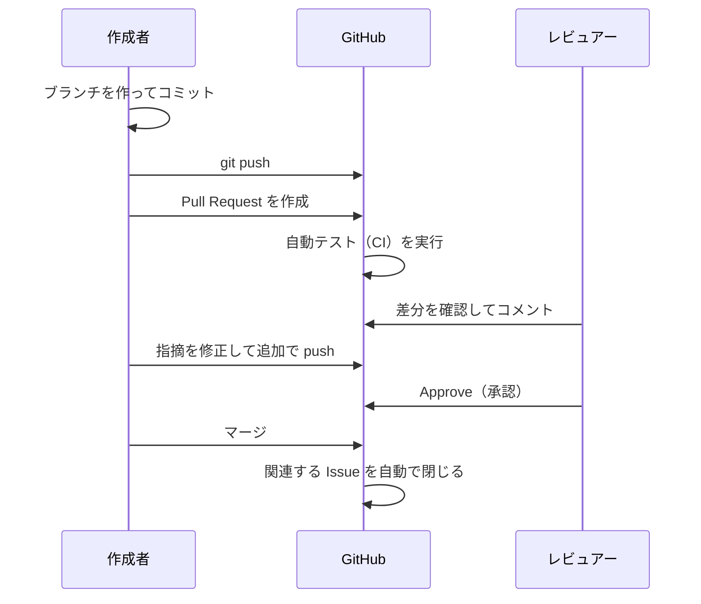

# 第 6 章: Pull Request

**Pull Request（プルリクエスト、略して PR）** は、「このブランチの変更を `main` に取り込んでください」とお願いし、取り込む前にレビューや自動テストを行うための GitHub の機能です。
チーム開発では、`main` への変更はすべて Pull Request を通して行うのが一般的です。

## この章のゴール

- [ ] Issue に対応するブランチを作り、修正をコミットして push できる（VS Code とコマンドの両方で）
- [ ] ブラウザ・`gh` コマンド・VS Code（GitHub Pull Requests 拡張機能）で Pull Request を作れる
- [ ] Pull Request と Issue を関連付け、マージ時に Issue を自動で閉じられる
- [ ] 差分にコメントしてレビューできる。レビューの指摘に対応できる
- [ ] 自動テスト（CI）の結果を確認できる
- [ ] Pull Request をマージし、手元のリポジトリを後片付けできる

**所要時間の目安:** 60〜90 分

## 6.1 Pull Request の流れ



この章では、[第 5 章](05-issue.md) で報告した「空の内容でタスクを追加できてしまう」不具合（Issue #1）を、Pull Request を通して修正します。

## 6.2 ブランチを作って修正する

この章の作業は、[第 5 章](05-issue.md#練習用リポジトリを-vs-code-で開く) で VS Code で開いた練習用リポジトリで行います。

### 作業ブランチを作る

最新の `main` から、Issue 番号を入れた名前のブランチ `fix/1-empty-task` を作ります。

#### VS Code で操作する

1. ステータス バーの左下のブランチ名をクリックし、一覧から `main` を選びます（すでに `main` なら、そのままで構いません）。
2. **ソース管理**（Source Control）ビューの上部にある **その他の操作...**（More Actions...、「…」のアイコン）> **プル**（Pull）を選び、最新の `main` を取り込みます。
3. もう一度ステータス バーのブランチ名をクリックし、「**+ 新しいブランチの作成...**」（Create new branch...）を選びます。
4. `fix/1-empty-task` と入力して <kbd>Enter</kbd> を押します。

ステータス バーの表示が `fix/1-empty-task` に変われば、新しいブランチに切り替わっています（[公式ドキュメント: Branches and Worktrees](https://code.visualstudio.com/docs/sourcecontrol/branches-worktrees)）。

#### コマンドで操作する

```bash
cd ~/git-practice/todo-cli-practice
git switch main
git pull                          # 最新の main から始める
git switch -c fix/1-empty-task    # Issue 番号を入れたブランチ名にする
```

### まずテストを書く

不具合を直す前に、「正しい動作」を確かめるテストを書いておくと、修正できたかどうかをすぐに確認できます。
VS Code で `tests/test_todo.sh` を開きます。次のどちらの方法でも開けます。

- **クイック オープン**（Quick Open）: <kbd>Ctrl</kbd> + <kbd>P</kbd>（macOS は <kbd>Command</kbd> + <kbd>P</kbd>）を押し、`test_todo` と入力して <kbd>Enter</kbd> を押します。
- **エクスプローラー**（Explorer）: `tests` フォルダを開き、`test_todo.sh` をクリックします。

`# list` の区切り線の直前に、次のテストを追加します。区切り線は、<kbd>Ctrl</kbd> + <kbd>F</kbd>（macOS は <kbd>Command</kbd> + <kbd>F</kbd>）で `# list` を検索すると見つかります。

```bash
reset_todo
run_todo add ""
assert_equal "add に空の内容を渡すと終了コード 1 で終わる" 1 "$STATUS"
assert_equal "add に空の内容を渡してもタスクは追加されない" "" "$(cat "$TODO_FILE" 2>/dev/null)"

run_todo add "   "
assert_equal "add に空白だけの内容を渡すと終了コード 1 で終わる" 1 "$STATUS"
```

ShellCheck 拡張機能（[0.9](00-setup.md#09-拡張機能を追加する)）を入れていれば、間違えやすい書き方をすると、その部分に波線が表示されます。マウスを合わせると理由が表示され、パネルの **問題**（Problems）タブにも一覧が表示されます。

テストを実行して、追加したテストが失敗する（＝不具合が再現できている）ことを確認します。テストは、VS Code のタスクでも、統合ターミナルのコマンドでも実行できます。

#### VS Code で操作する

練習用リポジトリの `.vscode/tasks.json` には、テストを実行する **タスク**「テストを実行」が用意されています（[公式ドキュメント: Tasks](https://code.visualstudio.com/docs/debugtest/tasks)）。

1. コマンド パレット（<kbd>Ctrl</kbd> + <kbd>Shift</kbd> + <kbd>P</kbd>、macOS は <kbd>Command</kbd> + <kbd>Shift</kbd> + <kbd>P</kbd>）を開き、「**タスク: テスト タスクの実行**」（Tasks: Run Test Task）を選びます。
   メニューの **ターミナル**（Terminal）> **タスクの実行...**（Run Task...）を選び、一覧から「**テストを実行**」を選んでも同じです。
2. パネルにタスク用のターミナルが開き、`bash tests/test_todo.sh` を実行した結果が表示されます。

タスク用のターミナルは、何かキーを押すと閉じます。タスクは制限モードでは動かないので、動かないときはフォルダを信頼しているか確認してください。

#### コマンドで操作する

統合ターミナルで、次のコマンドを実行します。

```bash
bash tests/test_todo.sh
```

どちらの方法でも、次のような結果が表示されます。

```text
...
FAIL - add に空の内容を渡すと終了コード 1 で終わる
       期待値: 1
       実際  : 0
...
結果: 34 件成功, 3 件失敗
```

### 修正する

VS Code で `todo.sh` を開き（クイック オープンで `todo.sh`）、`cmd_add` 関数を修正します。まずは自分で考えてみましょう。

<details>
<summary>修正例</summary>

```bash
# タスクを追加する
cmd_add() {
  local text="$*"
  # 空白以外の文字を 1 文字も含まない場合（空の内容）はエラーにする
  case "$text" in
    *[![:space:]]*) ;;
    *) die "追加するタスクの内容を指定してください（例: todo.sh add \"牛乳を買う\"）" ;;
  esac
  # 改行を含む内容は「1 行 1 タスク」の形式が崩れるので受け付けない
  case "$text" in
    *$'\n'*) die "タスクの内容に改行は含められません" ;;
  esac
  # エディタで編集したなどで、ファイルの最後が改行で終わっていない場合は、
  # 新しいタスクが前の行につながらないように改行を補う
  if [ -s "$TODO_FILE" ] && [ -n "$(tail -c 1 "$TODO_FILE")" ]; then
    echo >>"$TODO_FILE"
  fi
  printf '[ ] %s\n' "$text" >>"$TODO_FILE"
  echo "追加しました: $text"
}
```

関数の先頭にあった `if [ $# -eq 0 ]` のチェックを、`case` 文に置き換えています。
`*[![:space:]]*` は「空白以外の文字（`[![:space:]]`）を 1 文字でも含む」というパターンです。これに当てはまらない（＝空、または空白だけ）場合にエラーにしています。引数がない場合も内容が空になるので、元の `if` のチェックはこの `case` 文に含まれます。

</details>

もう一度テストを実行し（「タスク: テスト タスクの実行」、または `bash tests/test_todo.sh`）、すべて成功することを確認します。

```text
...
結果: 37 件成功, 0 件失敗
```

### コミットして push する

変更を確認してからコミットし、ブランチを GitHub に push します。

#### VS Code で操作する

1. **ソース管理**（Source Control）ビューを開きます（<kbd>Ctrl</kbd> + <kbd>Shift</kbd> + <kbd>G</kbd>、macOS は <kbd>Control</kbd> + <kbd>Shift</kbd> + <kbd>G</kbd>）。
2. **変更**（Changes）に `todo.sh` と `test_todo.sh` が表示されています。ファイル名をクリックすると、差分エディターで変更前（左）と変更後（右）を見比べられます（`git diff` と同じ内容です）。
3. それぞれのファイルにマウスを合わせ、**変更をステージ**（Stage Changes、**+** のアイコン）をクリックします。2 つとも **ステージされている変更**（Staged Changes）に移ります。
4. 上のメッセージ欄に `空の内容のタスクを追加できないようにする` と入力し、**コミット**（Commit）をクリックします。
5. **Branch の発行**（Publish Branch）をクリックすると、ブランチが GitHub に push されます。

統合ターミナルで `git log --oneline -1` を実行すると、コミットできたことを確かめられます（[公式ドキュメント: Staging and committing](https://code.visualstudio.com/docs/sourcecontrol/staging-commits)）。

#### コマンドで操作する

```bash
git status
git diff
git add todo.sh tests/test_todo.sh
git commit -m "空の内容のタスクを追加できないようにする"
git push -u origin fix/1-empty-task
```

push すると、次のようなメッセージが表示されます。

```text
remote:
remote: Create a pull request for 'fix/1-empty-task' on GitHub by visiting:
remote:      https://github.com/hanako/todo-cli-practice/pull/new/fix/1-empty-task
remote:
```

## 6.3 Pull Request を作る

ブラウザ・`gh` コマンド・VS Code（GitHub Pull Requests 拡張機能）のどれかで作成します。

### 方法 1: ブラウザで作る

1. リポジトリのページを開くと、「**fix/1-empty-task had recent pushes**」という黄色い帯と「**Compare & pull request**」ボタンが表示されているのでクリックします。
   （表示されない場合は、**Pull requests** タブ →「**New pull request**」から、ブランチを選びます。）
2. 画面上部で、**base: `main`** ← **compare: `fix/1-empty-task`** になっていることを確認します。「`fix/1-empty-task` の変更を `main` に取り込む」という意味です。
3. タイトルを入力します。例: `空の内容のタスクを追加できないようにする`
4. 本文には、テンプレート（`.github/pull_request_template.md`）の内容が入っています。見出しに沿って記入します。
   特に「関連する Issue」の **`Closes #1`** は重要です。こう書いておくと、この Pull Request がマージされたときに Issue #1 が自動で閉じます。
5. 右側で **Assignees** に自分を設定します。チームで開発している場合は **Reviewers** にレビューしてほしい人を指定します。
6. 「**Create pull request**」をクリックします。

> [!TIP]
> 「Create pull request」ボタンの `▼` から「**Create draft pull request**」を選ぶと、**ドラフト（下書き）** の Pull Request になります。
> 「まだ作業中だけど、方向性を早めに見てほしい」ときに使います。準備ができたら「Ready for review」ボタンで通常の Pull Request にします。

### 方法 2: gh コマンドで作る

```bash
gh pr create
```

対話形式でタイトルや本文を入力できます。
本文の入力では、テンプレートを元にした本文が VS Code のタブで開きます（[0.7](00-setup.md#github-cli-のエディタを-vs-code-にする) で `gh` のエディタを VS Code にしました）。書き終えたら保存し、タブを閉じる（<kbd>Ctrl</kbd> + <kbd>W</kbd>、macOS は <kbd>Command</kbd> + <kbd>W</kbd>）と、ターミナルで続きに進めます。
オプションで一度に指定することもできます。

````bash
gh pr create \
  --base main \
  --title "空の内容のタスクを追加できないようにする" \
  --assignee @me \
  --body-file - <<'EOF'
## 概要

空の内容（空白だけの内容を含む）でタスクを追加しようとしたときに、エラーにするようにしました。

## 関連する Issue

Closes #1

## 変更内容

- `cmd_add` で、空白以外の文字を含まない内容をエラーにする
- 空の内容・空白だけの内容のテストを追加

## 動作確認

```bash
$ ./todo.sh add ""
エラー: 追加するタスクの内容を指定してください（例: todo.sh add "牛乳を買う"）
$ bash tests/test_todo.sh
結果: 37 件成功, 0 件失敗
```

## チェックリスト

- [x] テスト（`bash tests/test_todo.sh`）がすべて成功する
- [x] 新しい機能や修正に対応するテストを追加した
- [x] 必要に応じて README.md の使い方を更新した
- [x] 自分で差分（Files changed タブ）を見直した
EOF
````

| オプション | 意味 |
| --- | --- |
| `--base main` | 取り込み先のブランチ |
| `--title` / `--body-file` | タイトル / 本文 |
| `--draft` | ドラフトとして作成する |
| `--reviewer <ユーザー名>` | レビュアーを指定する |
| `--web` | ブラウザの作成画面を開く |

作成した Pull Request は、次のコマンドで確認できます。

```bash
gh pr list            # Open の Pull Request の一覧
gh pr view            # 今のブランチの Pull Request の内容
gh pr view --web      # ブラウザで開く
```

### 方法 3: VS Code（GitHub Pull Requests 拡張機能）で作る

[5.6](05-issue.md#github-にサインインする) で GitHub にサインインしてあれば、VS Code の中で Pull Request を作れます（[公式ドキュメント: Working with GitHub](https://code.visualstudio.com/docs/sourcecontrol/github)）。

1. アクティビティ バーの **GitHub** を選び、**Pull Requests** の見出しにマウスを合わせて、**Create Pull Request** のアイコンをクリックします。
   コマンド パレットで「**GitHub Pull Requests: Create Pull Request**」を実行しても同じです。
2. **Create** の画面が開きます。取り込み先（base）が `main`、取り込むブランチ（merge）が `fix/1-empty-task` になっていることを確認します。
3. **Title** には、コミットメッセージ（`空の内容のタスクを追加できないようにする`）が入っています。
4. **Description** には、テンプレート（`.github/pull_request_template.md`）の内容が入っています。ブラウザで作るときと同じように記入し、**`Closes #1`** を書きます。
   テンプレートは GitHub 上の `main` ブランチから読み込まれるため、第 5 章で push したリポジトリなら、そのまま使えます。
5. 必要なら **Assignees** や **Reviewers** を設定し、**Create** をクリックします。**Create** の横の `∨` から **Create Draft** を選ぶと、ドラフトとして作成できます。

作成すると、Pull Request の内容（**Description** のページ）がエディターのタブで開きます。
ブランチをまだ push していない場合は、作成するときに push するかどうかを確認されるので、**Publish Branch** をクリックします。

> [!NOTE]
> Issue と Pull Request は同じ番号の連番を使います。Issue が #1〜#4 まであれば、次に作った Pull Request は #5 になります。

## 6.4 Pull Request の画面

| タブ | 内容 |
| --- | --- |
| **Conversation** | 本文・コメント・レビュー・自動テストの結果・マージボタン |
| **Commits** | この Pull Request に含まれるコミットの一覧 |
| **Checks** | 自動テスト（CI）の詳細な結果 |
| **Files changed** | 変更されたファイルの差分。**レビューはここで行う** |

VS Code では、**GitHub** ビューの **Pull Requests** のセクション（**Created By Me** や **All Open** など）で Pull Request をクリックすると、**Description** のページが開きます。本文・コメント・自動テストの結果・マージボタンが 1 つのページにまとまっています。

### 自動テスト（CI）を確認する

練習用リポジトリには `.github/workflows/test.yml` があるので、Pull Request を作ると **GitHub Actions** がテストを自動で実行します。
このように、変更のたびに自動でテストなどを実行する仕組みを **CI（継続的インテグレーション）** と呼びます。

ブラウザでは、Conversation タブの下部に、結果が表示されます。

| 表示 | 意味 |
| --- | --- |
| 黄色の丸 | 実行中 |
| 緑色のチェック ✓ | 成功 |
| 赤色のバツ ✗ | 失敗。「**Details**」をクリックするとログを確認できる |

CI が失敗したら、ログでどのテストが失敗したかを確認し、手元で修正してコミット・push します。push すると CI が再実行されます。

#### VS Code で操作する

Pull Request の **Description** のページの下部に、`1 successful check`（成功）や `1 failed check`（失敗）のように結果がまとめて表示されます。
**Show** をクリックすると、チェックごとの結果が表示されます。**Details** をクリックすると、ブラウザでログを確認できます。

#### コマンドで操作する

ターミナルからも確認できます。

```bash
gh pr checks
```

## 6.5 レビューする

**レビュー** は、他の人が変更内容を確認し、問題点や改善点を指摘することです。バグの早期発見だけでなく、知識の共有にも役立ちます。

### コメントを書く

1. **Files changed** タブを開きます。
2. コメントしたい行にマウスを合わせると表示される「**+**」をクリックします（行番号をドラッグすると複数行を選べます）。
3. コメントを書き、「**Start a review**」をクリックします（すぐに投稿したい場合は「Add single comment」）。
4. 必要なだけコメントを追加したら、右上の「**Review changes**」（または「**Submit review**」）をクリックし、種類を選んで「**Submit review**」します。

| 種類 | 意味 |
| --- | --- |
| **Comment** | 意見や質問だけ。承認も差し戻しもしない |
| **Approve** | 承認する（マージしてよい） |
| **Request changes** | 修正を求める（修正されるまでマージしないでほしい） |

> [!NOTE]
> **自分が作った Pull Request は Approve できません。** 1 人で練習するときは「Comment」でセルフレビューしましょう。
> 友だちや同僚と一緒に学んでいる場合は、お互いの練習用リポジトリにコラボレーターとして招待し合い、レビューし合うのがおすすめです（[第 7 章](07-github-flow.md)）。

### 修正案（suggestion）を送る

コメント欄の「±」アイコン（Add a suggestion）をクリックすると、次のようなブロックが入力されます。

````markdown
```suggestion
修正後のコード
```
````

この中身を書き換えて投稿すると、作成者は「**Commit suggestion**」ボタンを押すだけで、その修正をコミットできます。

### VS Code でレビューする

GitHub Pull Requests 拡張機能を使うと、Pull Request のブランチを手元に取得して動作を確かめながら、VS Code の中でレビューできます（[公式ドキュメント: Working with GitHub](https://code.visualstudio.com/docs/sourcecontrol/github)）。

1. **GitHub** ビューの **Pull Requests** で、レビューする Pull Request をクリックし、**Description** のページを開きます。
2. **Checkout** をクリックします。Pull Request のブランチが手元に取得され、そのブランチに切り替わります（`gh pr checkout` と同じです）。テスト タスクを実行して、動作を確かめられます。
3. アクティビティ バーに **GitHub Pull Request** のビューが追加され、**Changes In Pull Request** に変更されたファイルが表示されます。ファイルをクリックすると、差分エディターが開きます。
4. コメントしたい行の行番号の横にマウスを合わせ、表示される **+** をクリックします。コメントを書き、**Add Comment**（すぐに投稿する）か **Start Review**（まとめて送るレビューを始める）をクリックします。
5. **Description** のページに戻り、下部の入力欄に全体のコメントを書いて、**Comment** / **Approve** / **Request Changes** のどれかで送信します（ボタンの横の `∨` で切り替えられます）。

自分が作った Pull Request では、ブラウザと同じく **Comment** だけが選べます。
レビューが終わったら、ステータス バーのブランチ名をクリックして `main` に戻ります。

修正案（suggestion）を送ったり、「**Commit suggestion**」で取り込んだりするのは、ブラウザの **Files changed** タブで行うのが確実です。

### gh コマンドでレビューする

```bash
gh pr checkout 5                                  # #5 のブランチを手元に取得して切り替える（動作確認用）
gh pr diff 5                                      # 差分を表示する
gh pr review 5 --comment --body "テストも追加されていて分かりやすいです"
gh pr review 5 --approve                          # 承認する
gh pr review 5 --request-changes --body "空白だけの場合も確認してください"
```

### レビューのマナー

#### レビューする側

- 人ではなく **コード** について書く（「あなたは間違っている」ではなく「この処理は〜の場合に動かないかもしれません」）
- 指摘には **理由** を添える
- 必須の修正か、好みの問題かを区別する（好みの問題には `nit:`（細かい指摘）や `[任意]` などを付ける）
- 良いところも伝える

#### レビューを受ける側

- 指摘は人格への批判ではなく、より良いコードにするための意見として受け取る
- 対応したら、どう対応したか（コミットへのリンクなど）を返信し、「**Resolve conversation**」を押す
- 対応しない場合も、理由を返信する

### 指摘に対応する

レビューで修正を求められたら、**同じブランチ** で修正してコミットし、push します。
Pull Request は自動で更新されるので、新しく作り直す必要はありません。

#### VS Code で操作する

1. ステータス バーのブランチ名が `fix/1-empty-task` になっていることを確認します。
2. ファイルを修正して保存し、**ソース管理** ビューで変更をステージして、メッセージ（例: `レビューの指摘を反映: エラーメッセージを修正`）を入力して **コミット** をクリックします。
3. **変更の同期**（Sync Changes）をクリックすると、追加したコミットが push されます。

#### コマンドで操作する

```bash
# fix/1-empty-task ブランチにいることを確認してから
git status
# ... 修正 ...
git commit -am "レビューの指摘を反映: エラーメッセージを修正"
git push
```

## 6.6 マージする

レビューで承認され、CI が成功したらマージします。マージの方法は 3 種類あり、「**Merge pull request**」ボタンの `▼` で選べます。

| 方法 | 動作 | 向いている場面 |
| --- | --- | --- |
| **Create a merge commit** | ブランチのコミットをすべて残し、マージコミットを作る | 作業の経緯をすべて残したいとき |
| **Squash and merge** | ブランチのコミットを 1 つにまとめてから取り込む | 「修正」「typo 修正」などの細かいコミットをまとめて、`main` の履歴を読みやすくしたいとき |
| **Rebase and merge** | マージコミットを作らず、コミットを `main` の先頭に並べ直す | 履歴を一直線にしたいとき |

どれを使うかはチームで決めます。迷ったら **Squash and merge** がおすすめです（1 つの Pull Request が `main` の 1 コミットになり、履歴が分かりやすくなります）。

ブラウザでは、次の手順でマージします。

1. 「**Squash and merge**」を選び、ボタンをクリックします。
2. コミットメッセージを確認して「**Confirm squash and merge**」をクリックします。
3. 「**Delete branch**」ボタンが表示されるので、クリックして GitHub 上のブランチを削除します。

どの方法でマージしても、マージ後に Issue #1 を開くと、自動で **Closed** になっていることを確認できます。

### VS Code で操作する

GitHub Pull Requests 拡張機能でもマージできます。

1. Pull Request の **Description** のページを開きます。
2. 下部の **Merge Pull Request** の右にある一覧（using method）から **Squash and Merge** を選び、**Merge Pull Request** をクリックします。
3. コミットメッセージの入力欄が表示されるので、内容を確認して **Squash and Merge** をクリックします。
4. マージが終わると **Delete Branch...** が表示されるので、クリックします。
5. 何を削除するかを聞かれるので、**Delete All** を選びます。GitHub 上のブランチと手元のブランチが削除され、手元は `main` に切り替わります。

### コマンドで操作する

`gh` コマンドでもマージできます。

```bash
gh pr merge 5 --squash --delete-branch
```

## 6.7 マージ後の後片付け

手元のリポジトリを最新の状態にし、不要になったブランチを削除します。

### VS Code で操作する

1. ステータス バーのブランチ名をクリックし、`main` を選びます。
2. **ソース管理** ビューの **変更の同期**（Sync Changes）をクリックし、マージされた変更を取り込みます。**その他の操作...**（More Actions...、「…」のアイコン）> **プル**（Pull）でも構いません。
3. コマンド パレットで「**Git: フェッチ (Prune)**」（Git: Fetch (Prune)）を実行し、GitHub で削除されたブランチの情報を手元からも消します。
4. コマンド パレットで「**Git: ブランチの削除...**」（Git: Delete Branch...）を実行し、`fix/1-empty-task` を選びます。

Squash and merge でマージした場合は、4 で「ブランチ 'fix/1-empty-task' はマージされていません。それでも削除しますか?」と確認されます（理由は下の NOTE を参照）。

> [!WARNING]
> ここで **ブランチの削除**（Delete Branch）をクリックすると、`git branch -D` と同じく強制的に削除されます。GitHub で Pull Request がマージ済み（**Merged**）になっていることを確認してから削除してください。

6.6 の VS Code の手順で **Delete All** を選んだ場合は、手元のブランチの削除と `main` への切り替えまで済んでいるので、2 だけを行います。

### コマンドで操作する

```bash
git switch main
git pull                          # マージされた変更を取り込む
git fetch --prune                 # GitHub で削除されたブランチの情報を手元からも消す
git branch -d fix/1-empty-task    # 手元のブランチを削除する
```

> [!NOTE]
> **Squash and merge** や **Rebase and merge** でマージした場合、手元のブランチのコミットと `main` のコミットは別物になるため、`git branch -d` は「まだマージされていない」というエラーを出します。
> GitHub でマージ済みであることを確認したうえで、`git branch -D fix/1-empty-task`（大文字の `D`）で削除してください。
> `gh pr merge --delete-branch` でマージした場合は、手元のブランチの削除と `main` への切り替えまで自動で行われます。

## 6.8 良い Pull Request のコツ

- **小さく保つ**: 1 つの Pull Request には 1 つの目的だけを含めます。変更が大きいほど、レビューは難しくなり、見落としも増えます。
- **説明を書く**: 「何を」だけでなく「なぜ」変更したのかを書きます。レビュアーが判断に必要な情報（動作確認の方法、画面の変更ならスクリーンショット）を添えます。
- **Issue と関連付ける**: `Closes #番号` を書きます。
- **自分で先にレビューする**: レビューを依頼する前に、Files changed タブで自分の差分を見直します。消し忘れたデバッグ用の出力や、関係ない変更が見つかることがよくあります。
- **CI を通してからレビューを依頼する**: テストが失敗したままの Pull Request は、レビュアーの時間を無駄にします。

## 演習

### 演習 6-1: バグを修正する Pull Request を作る

本文の手順に沿って、Issue #1（空の内容でタスクを追加できてしまう）を修正する Pull Request を作り、マージしてください。
ブランチの作成・コミット・push・Pull Request の作成とマージは、VS Code とコマンドのどちらで行っても構いません。慣れてきたら、もう一方の方法も試してみましょう。

- [ ] `fix/1-empty-task` ブランチを作った
- [ ] テストを追加し、修正前は失敗することを確認した
- [ ] 修正後、すべてのテストが成功することを確認した
- [ ] Pull Request の本文に `Closes #1` を書いた
- [ ] CI が成功した
- [ ] Squash and merge でマージし、ブランチを削除した
- [ ] Issue #1 が自動で閉じた
- [ ] 手元の `main` を最新にし、作業ブランチを削除した

### 演習 6-2: セルフレビューと指摘への対応

1. 新しく `docs/update-usage` ブランチを作り、`README.md` の「使い方」に `./todo.sh version` の説明を追加して Pull Request を作ってください（VS Code で `README.md` を開いて編集し、<kbd>Ctrl</kbd> + <kbd>Shift</kbd> + <kbd>V</kbd>（macOS は <kbd>Command</kbd> + <kbd>Shift</kbd> + <kbd>V</kbd>）のプレビューで表示を確かめましょう）。
2. Files changed タブで、追加した行に suggestion（修正案）付きのコメントを書き、「Comment」としてレビューを送信してください。
3. 「Commit suggestion」で修正案をコミットしてください。
4. コメントに返信して「Resolve conversation」を押してから、マージしてください。

### 演習 6-3: CI の失敗を体験する

1. 新しくブランチを作り、`todo.sh` の `VERSION` を `"1.0.1"` に変更して、Pull Request を作ってください。
2. CI が **失敗** することを確認し、「Details」からログを読んで原因を特定してください（ブラウザの Pull Request の画面、VS Code の **Description** のページ、`gh pr checks` のどれでも確認できます）。
3. テストを修正して push し、CI が成功することを確認してからマージしてください。

<details>
<summary>ヒント</summary>

`tests/test_todo.sh` に、バージョンの表示を確認するテスト（`"todo.sh 1.0.0"` を期待しているテスト）があります。
仕様を変更したら、それに合わせてテストも更新する必要があります。

VS Code では、`main` を最新にしてから「**+ 新しいブランチの作成...**」で `chore/bump-version` を作り、`todo.sh` の `VERSION` を書き換えて **ソース管理** ビューからコミットし、**Branch の発行** → **Create Pull Request** の順に進めます。
テストを直したら、テスト タスクで成功を確認してからコミットし、**変更の同期** で push します。

コマンドで行う場合は、次のとおりです。

```bash
git switch main && git pull
git switch -c chore/bump-version
# todo.sh の VERSION を "1.0.1" に変更
git commit -am "バージョンを 1.0.1 に更新"
git push -u origin chore/bump-version
gh pr create --fill               # --fill: コミットメッセージからタイトルと本文を作る
gh pr checks                      # 失敗を確認

# tests/test_todo.sh の "todo.sh 1.0.0" を "todo.sh 1.0.1" に変更
bash tests/test_todo.sh
git commit -am "バージョンのテストを更新"
git push
gh pr checks                      # 成功を確認
```

</details>

## まとめ

- Pull Request は「変更を取り込む前に、レビューと自動テストを行う」ための仕組み
- 「Issue → ブランチ → コミット → push → Pull Request → レビュー・CI → マージ → 後片付け」が基本の流れ。ブラウザ・`gh` コマンド・VS Code のどれでも進められる
- 本文に `Closes #番号` と書くと、マージ時に Issue が自動で閉じる
- 指摘への対応は、同じブランチに追加で push する
- 小さく、説明付きで、自分で見直してからレビューを依頼する

---

[← 前の章: Issue](05-issue.md) ｜ [目次](../README.md) ｜ [次の章: 開発フローの総合演習 →](07-github-flow.md)
