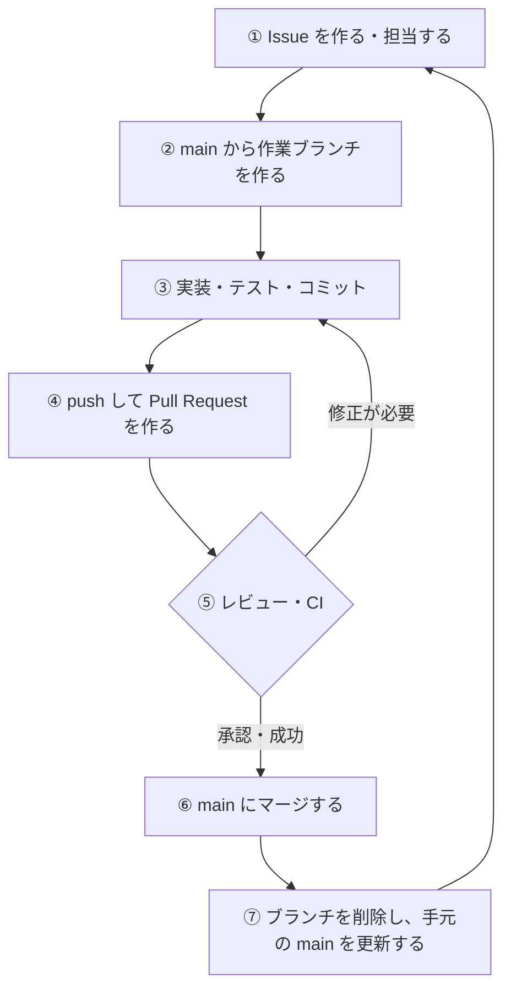

# 第 7 章: 開発フローの総合演習

ここまでに学んだ Issue・ブランチ・Pull Request を組み合わせて、実際の開発と同じ流れで機能を追加します。
この流れは **GitHub Flow** と呼ばれ、多くのチームで使われているシンプルな開発の進め方です。

## この章のゴール

- [ ] GitHub Flow の流れを説明できる
- [ ] Issue の作成からマージ・後片付けまでを、資料を見ずに一通り実行できる（VS Code でもコマンドでも）
- [ ] 複数の機能を、それぞれ別の Issue・ブランチ・Pull Request で進められる
- [ ] （チームで学ぶ場合）他の人の Pull Request をレビューし、コンフリクトを解消できる

**所要時間の目安:** 90〜180 分

## 7.1 GitHub Flow



GitHub Flow のルールは、次の 4 つだけです。

1. **`main` ブランチは常に正しく動く状態に保つ**
2. 作業は **`main` から作ったブランチ** で行う
3. ブランチは **こまめに push** し、作業内容を共有する
4. **Pull Request でレビューと CI を通してから** `main` にマージする

## 7.2 総合演習: delete コマンドを追加する

[第 5 章](05-issue.md) で作った Issue #2「タスクを削除する delete コマンドを追加したい」に取り組みます。
各ステップは、これまでの章を見返しながら、なるべく自分で考えて進めてみましょう。
それぞれのステップには、VS Code で操作する方法とコマンドで操作する方法を載せています。どちらで進めても、結果は同じです。

### 仕様

```text
$ ./todo.sh list
  1 [ ] 牛乳を買う
  2 [x] 部屋を掃除する
  3 [ ] 本を読む
$ ./todo.sh delete 2
削除しました: 部屋を掃除する
$ ./todo.sh list
  1 [ ] 牛乳を買う
  2 [ ] 本を読む
$ ./todo.sh delete 5
エラー: 5 番のタスクはありません（todo.sh list で番号を確認してください）
```

- `delete <番号>` で、指定した番号のタスクを削除する（完了・未完了どちらでも）
- 番号が数字でない、または存在しない番号の場合はエラーにして、終了コード 1 で終わる
- `help` の表示と `README.md` の「使い方」に `delete` を追加する

### ステップ 1: Issue を確認して担当する

#### VS Code で操作する

1. 練習用リポジトリを VS Code で開き、アクティビティ バーの **GitHub** を選びます。
2. **Issues** の **Recent Issues** にある #2 をクリックして、内容を確認します。
3. Issue のタブの右側の **Assignees** をクリックし、自分を選びます。

#### コマンドで操作する

```bash
cd ~/git-practice/todo-cli-practice
gh issue view 2
gh issue edit 2 --add-assignee @me
```

### ステップ 2: 最新の main からブランチを作る

#### VS Code で操作する

1. ステータス バーのブランチ名をクリックして `main` を選び、**その他の操作...**（More Actions...、「…」のアイコン）> **プル**（Pull）で最新にします。
2. もう一度ブランチ名をクリックし、「**+ 新しいブランチの作成...**」（Create new branch...）を選んで、`feature/2-delete-command` と入力します。

> [!TIP]
> **Issues** で Issue にマウスを合わせると表示される矢印のアイコン（**Start Working on Issue and Checkout Topic Branch**）をクリックすると、Issue の担当者に自分を設定し、ブランチを作って切り替えるところまで一度に行えます（右クリックのメニューの **Start Working on Issue** でも同じです）。
> ただし、作られるブランチの名前は `<あなたのユーザー名>/issue2` のようになります（設定 `githubIssues.issueBranchTitle` の初期値が `${user}/issue${issueNumber}` のため）。この教材のように `feature/2-delete-command` という名前にしたいときは、設定（<kbd>Ctrl</kbd> + <kbd>,</kbd>、macOS は <kbd>Command</kbd> + <kbd>,</kbd>）で `githubIssues.useBranchForIssues` を検索して `prompt` に変えます。すると、ブランチ名を入力する欄（Enter the label for the new branch.）が表示されるので、名前を書き換えられます。
> ブランチは今いるブランチから作られるので、先に 1 の手順で `main` を最新にしておきます。また、**ソース管理** のメッセージ欄に Issue のタイトルと `Fixes #2` が入力されるので、コミットするときに書き換えて使います。

#### コマンドで操作する

```bash
git switch main
git pull
git switch -c feature/2-delete-command
```

> [!TIP]
> `gh issue develop 2 --name feature/2-delete-command --checkout` を使うと、Issue と関連付けられたブランチを GitHub 上に作り、手元に切り替えるところまで一度に行えます。

### ステップ 3: テストを書き、実装する

1. `tests/test_todo.sh` を VS Code で開き（クイック オープン: <kbd>Ctrl</kbd> + <kbd>P</kbd>、macOS は <kbd>Command</kbd> + <kbd>P</kbd>）、`delete` のテストを追加します（`# 結果` の区切り線の直前）。
2. テストが失敗することを確認します（コマンド パレットの「**タスク: テスト タスクの実行**」、または統合ターミナルで `bash tests/test_todo.sh`）。
3. `todo.sh` に `cmd_delete` 関数を追加し、`main` 関数の `case` 文と `usage` 関数を更新します。
4. テストがすべて成功することを確認します。
5. `README.md` の「使い方」を更新します（<kbd>Ctrl</kbd> + <kbd>Shift</kbd> + <kbd>V</kbd>、macOS は <kbd>Command</kbd> + <kbd>Shift</kbd> + <kbd>V</kbd> のプレビューで表示を確かめられます）。

<details>
<summary>テストの例</summary>

```bash
# ---------------------------------------------------------------------------
# delete
# ---------------------------------------------------------------------------

reset_todo
run_todo add "牛乳を買う"
run_todo add "部屋を掃除する"
run_todo add "本を読む"
run_todo "done" 2
run_todo delete 2
assert_equal "delete は終了コード 0 で終わる" 0 "$STATUS"
assert_equal "delete は削除したタスクを表示する" "削除しました: 部屋を掃除する" "$OUTPUT"
expected=$(printf '[ ] 牛乳を買う\n[ ] 本を読む')
assert_equal "delete は指定したタスクだけを削除する" "$expected" "$(cat "$TODO_FILE")"

for bad in 0 3 abc; do
  run_todo delete "$bad"
  assert_equal "delete に不正な番号（${bad}）を渡すと終了コード 1 で終わる" 1 "$STATUS"
done
```

</details>

<details>
<summary>実装の例</summary>

`todo.sh` の `main()` 関数の直前に、次の関数を追加します。番号のチェックは `cmd_done` と同じで、件数を数える `count_tasks` と、ファイルを書き換える `rewrite_tasks` も `cmd_done` と同じものを使います。

```bash
# 指定した番号のタスクを削除する
cmd_delete() {
  if [ $# -ne 1 ]; then
    die "削除するタスクの番号を 1 つ指定してください（例: todo.sh delete 1）"
  fi
  case "$1" in
    '' | *[!0-9]*) die "番号は数字で指定してください: $1" ;;
  esac
  local num=$((10#$1))

  local total
  total=$(count_tasks)
  if [ "$num" -lt 1 ] || [ "$num" -gt "$total" ]; then
    die "${num} 番のタスクはありません（todo.sh list で番号を確認してください）"
  fi

  local line
  line=$(sed -n "${num}p" "$TODO_FILE")

  # n 行目以外の行だけを残す（= n 行目を削除する）
  rewrite_tasks -v n="$num" 'NR != n'
  echo "削除しました: ${line#\[?\] }"
}
```

- `rewrite_tasks -v n="$num" 'NR != n'` は、awk で「行番号（`NR`）が `n` ではない行だけを残す」、つまり `n` 行目を取り除く処理です。
- `${line#\[?\] }` は、行の先頭の `[ ]` または `[x]` と、その後ろの空白を取り除いた文字列です（`?` は任意の 1 文字）。

`main()` の `case` 文と、`usage()` のヘルプにも追加します。

```bash
    done) cmd_done "$@" ;;
    delete | rm) cmd_delete "$@" ;;
```

```text
  done <番号>   指定した番号のタスクを完了にする
  delete <番号> 指定した番号のタスクを削除する（rm でも可）
```

</details>

**コミットは、意味のあるまとまりごとに分けましょう。** 例えば、「テストと実装」と「README の更新」の 2 つのコミットに分けられます。

#### VS Code で操作する

1. **ソース管理** ビューの **変更** で、`test_todo.sh` と `todo.sh` だけを **変更をステージ**（**+**）でステージします。
2. メッセージ欄に `タスクを削除する delete コマンドを追加` と入力し、**コミット** をクリックします。
3. 残った `README.md` をステージし、`README に delete コマンドの使い方を追加` と入力して **コミット** をクリックします。

ソース管理ビューの **グラフ**（Graph）か、統合ターミナルの `git log --oneline -3` で、コミットが 2 つに分かれていることを確かめましょう。

#### コマンドで操作する

```bash
git add tests/test_todo.sh todo.sh
git commit -m "タスクを削除する delete コマンドを追加"
git add README.md
git commit -m "README に delete コマンドの使い方を追加"
```

### ステップ 4: push して Pull Request を作る

Pull Request のタイトルと本文は、次のようにします。

- タイトル: `タスクを削除する delete コマンドを追加`
- 本文: テンプレートに沿って記入し、**`Closes #2`** を忘れずに書く

#### VS Code で操作する

1. **ソース管理** ビューの **Branch の発行**（Publish Branch）をクリックします。
2. **GitHub** ビューの **Pull Requests** の見出しにある **Create Pull Request** のアイコンをクリックし、取り込み先（base）が `main` であることを確認します。
3. コミットが 2 つあるので、**Title** にはブランチ名から作った文字列（`Feature/2 delete command`）が入っています。上のタイトルに書き換えます。
4. **Description** に本文を記入し、**Create** をクリックします。

詳しくは [6.3 の方法 3](06-pull-request.md#方法-3-vs-codegithub-pull-requests-拡張機能で作る) を参照してください。

#### コマンドで操作する

```bash
git push -u origin feature/2-delete-command
gh pr create
```

### ステップ 5: セルフレビューと CI の確認

差分を見ながら、次の点を自分で確認しましょう。

- [ ] 関係のない変更（空白だけの変更、デバッグ用の `echo` など）が入っていない
- [ ] `help` と `README.md` の説明が実装と一致している
- [ ] CI が成功している

#### VS Code で操作する

1. **GitHub** ビューの **Pull Requests** で作った Pull Request をクリックし、**Description** のページを開きます。下部で CI の結果を確認できます。
2. **Pull Requests** の一覧で Pull Request の左の `>` をクリックして開くと、変更されたファイルが表示されます。クリックすると差分エディターで確認できます。

ブラウザの **Files changed** タブで確認しても構いません。

#### コマンドで操作する

```bash
gh pr checks
gh pr view --web      # ブラウザで開き、Files changed タブで差分を確認する
```

### ステップ 6: マージする

#### VS Code で操作する

**Description** のページの **Merge Pull Request** で、**Squash and Merge** を選んでマージし、**Delete Branch...** → **Delete All** でブランチを削除します（[6.6](06-pull-request.md#66-マージする)）。

#### コマンドで操作する

```bash
gh pr merge --squash --delete-branch
```

### ステップ 7: 後片付け

#### VS Code で操作する

1. ステータス バーのブランチ名が `main` になっていることを確認します（**Delete All** を選んだ場合は切り替え済みです。なっていなければ、クリックして `main` を選びます）。
2. **変更の同期**（Sync Changes）か、**その他の操作...** > **プル** で、マージされた変更を取り込みます。
3. **グラフ** で、`main` に「タスクを削除する delete コマンドを追加」のコミットが入ったことを確認します。
4. **GitHub** ビューの **Issues** を確認します。一覧には Open の Issue だけが表示されるので、#2 がなくなっていれば Closed になっています（表示が変わらないときは、**Issues** の見出しの **Refresh** のアイコンをクリックします）。

手元のブランチを削除していない場合は、[6.7](06-pull-request.md#67-マージ後の後片付け) の手順で削除します。

#### コマンドで操作する

```bash
git switch main       # gh pr merge --delete-branch を使った場合は切り替え済み
git pull
git log --oneline -5
gh issue view 2       # Closed になっていることを確認
```

## 7.3 チャレンジ課題

同じ流れで、次の機能を 1 つずつ追加してみましょう。**1 つの機能につき、1 つの Issue・1 つのブランチ・1 つの Pull Request** です。
慣れてきたら、資料を見ずに「Issue → マージ → 後片付け」まで進められるか試してみてください。

| 課題 | 仕様 | ヒント |
| --- | --- | --- |
| `undone <番号>` | 完了したタスクを未完了に戻す | `cmd_done` の `[ ]` と `[x]` を逆にする |
| `clear` | 完了したタスクをすべて削除する | `grep -v '^\[x\]'` で完了以外の行だけを残す |
| `search <キーワード>` | キーワードを含むタスクだけを、元の番号付きで表示する | `grep -n -F` で行番号付きで探せる |
| リファクタリング | `cmd_done` と `cmd_delete` で重複している番号のチェックを、1 つの関数にまとめる | ブランチ名は `refactor/...`。動作は変えずに、テストがすべて成功することを確認する |

タスクの件数と完了率を表示する `stats` コマンドは、[発展編](claude-code/README.md) の [第 6 章](claude-code/06-tdd.md) で、Claude Code と一緒にテスト駆動開発（TDD）で作ります。

> [!TIP]
> 複数の機能を同時に進めると、`usage()` や `main()` の `case` 文で **コンフリクト** が起きることがあります。
> そのときは、作業ブランチに最新の `main` を取り込んで解消します。
>
> ```bash
> git switch feature/xxx
> git fetch
> git merge origin/main      # コンフリクトしたら第 4 章の手順で解消する
> bash tests/test_todo.sh
> git push
> ```
>
> VS Code では、ステータス バーのブランチ名から作業ブランチに切り替え、**ソース管理** ビューの **その他の操作...**（More Actions...、「…」のアイコン）> **フェッチ**（Fetch）を選びます。続けて、コマンド パレットで「**Git: マージ...**」（Git: Merge...）を実行し、`origin/main` を選びます。
> コンフリクトしたら、[第 4 章](04-branch.md#45-コンフリクト競合を解消する) の CodeLens やマージ エディターで解消してコミットします。テスト タスクで成功を確かめてから、**変更の同期** で push します。
>
> 簡単なコンフリクトなら、Pull Request の画面の「**Resolve conflicts**」ボタンから、ブラウザ上で解消することもできます。

## 7.4 チームで練習する

2〜4 人で学んでいる場合は、1 つのリポジトリを共有して開発してみましょう。レビューやコンフリクトなど、1 人では体験しにくいことを練習できます。

### 準備

1. 代表者 1 人が、[第 5 章](05-issue.md#52-練習用リポジトリを準備する) の手順で練習用リポジトリ（例: `todo-cli-team`）を作ります。
2. 代表者が **Settings → Collaborators → Add people** から、メンバーを招待します。
3. 招待されたメンバーは、届いたメール（または <https://github.com/notifications>）から招待を承認し、リポジトリを clone します。

   ```bash
   cd ~/git-practice
   gh repo clone <代表者のユーザー名>/todo-cli-team
   code todo-cli-team
   ```

   VS Code のコマンド パレットで「**Git: クローン**」（Git: Clone）を実行し、「**GitHub から複製**」（Clone from GitHub）を選んで clone することもできます。

### ブランチを保護する（任意）

`main` に直接 push できないようにし、「Pull Request の承認と CI の成功」をマージの条件にできます。

1. **Settings → Rules → Rulesets** を開き、「**New ruleset**」→「**New branch ruleset**」を選びます。
2. **Ruleset Name** に `main を保護` などの名前を付け、**Enforcement status** を `Active` にします。
3. **Target branches** の「**Add target**」から「**Include default branch**」を選び、`main` を対象にします。
4. 次の項目を有効にします。
   - **Require a pull request before merging**（Pull Request を必須にする）
     - **Required approvals**: `1`（1 人以上の承認を必須にする）
   - **Require status checks to pass**（CI の成功を必須にする）→「**Add checks**」から `test` を追加
5. 「**Create**」で保存します。

> [!NOTE]
> ブランチの保護は、**公開リポジトリ** であれば無料プランで使えます。非公開リポジトリで使うには、有料プラン（GitHub Pro / Team など）が必要です。

### 進め方

1. [samples/todo-cli/README.md の「練習用の課題」](../samples/todo-cli/README.md#練習用の課題) や [7.3](#73-チャレンジ課題) の課題を、全員で Issue にします。
2. 各自が Issue を選び、自分を **Assignee** にしてから作業を始めます。
3. Pull Request を作ったら、他のメンバーを **Reviewers** に指定します。
4. レビューを依頼された人は、`gh pr checkout <番号>`（VS Code では Pull Request の **Checkout**、[6.5](06-pull-request.md#vs-code-でレビューする)）で手元でも動作を確認し、コメントや Approve をします。
5. 承認されたら、**作成者が** マージします。
6. 他の人の Pull Request がマージされたら、自分の作業ブランチに `main` を取り込み、コンフリクトがあれば解消します。

### わざとコンフリクトを起こしてみる

2 人が同時に、`usage()` のヘルプの同じ場所（`done` の行の下）に別々のコマンドを追加すると、後からマージする方の Pull Request で必ずコンフリクトが起きます。
先にマージされた方の変更を取り込んで、両方のコマンドが使えるように解消してみましょう。

## 7.5 振り返り

次の質問に、自分の言葉で答えられるか確認しましょう。

- [ ] なぜ `main` に直接コミットせず、ブランチと Pull Request を使うのか
- [ ] 良い Issue・良い Pull Request には何が書かれているか
- [ ] CI が失敗したとき、どこを見て何をすればよいか
- [ ] push が拒否されたとき、コンフリクトが起きたとき、それぞれどうするか
- [ ] マージした後に手元で何をするか

## まとめ

- GitHub Flow は「`main` から作ったブランチで作業し、Pull Request でレビューと CI を通してからマージする」シンプルな開発フロー
- 1 つの目的に、1 つの Issue・1 つのブランチ・1 つの Pull Request
- テストを書き、CI で自動確認することで、`main` を常に正しく動く状態に保つ
- チームでは、担当者を明確にし、お互いにレビューし合う

お疲れさまでした。これで、GitHub を使った基本的な開発の流れを一通り体験できました。
困ったときは [第 8 章: 困ったときは](08-troubleshooting.md) と [付録](../README.md#付録) を参照してください。

---

[← 前の章: Pull Request](06-pull-request.md) ｜ [目次](../README.md) ｜ [次の章: 困ったときは →](08-troubleshooting.md) ｜ [発展編: Claude Code と TDD →](claude-code/README.md)
