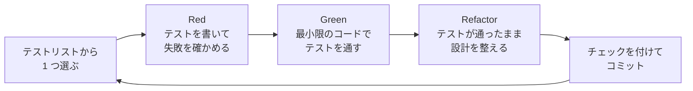

# 発展編 第 6 章: 追加課題: t-wada 流 TDD で stats コマンドを作る

発展編のまとめとして、Claude Code と一緒に **テスト駆動開発（TDD）** で `todo.sh` に新しい `stats` コマンドを作ります。
チェックボックス付きの **テストリスト** を 1 項目ずつ消化しながら、**Red → Green → Refactor** のサイクルを体験します。

本編の [第 6 章](../06-pull-request.md) では「まずテストを書く」で不具合を直しました。この章では、それをもう一歩進めて、**テストで設計を少しずつ進める** やり方を学びます。

> [!NOTE]
> この章の Claude Code の操作は 2026 年 10 月時点のものです。Claude の返答や作るコードは、実行するたびに少しずつ変わります。この章の出力例と同じでなくても、TDD の流れに沿っていれば問題ありません。

## この章のゴール

- [ ] TDD の流れ（テストリスト → Red → Green → Refactor）を説明できる
- [ ] 仮実装、三角測量、明白な実装を使い分けられる
- [ ] Claude Code と 1 サイクルずつ TDD を進め、サイクルごとにコミットできる
- [ ] AI と TDD を組み合わせるときに、気を付けることを説明できる

**所要時間の目安:** 90〜180 分

## A6.1 TDD とは

**テスト駆動開発**（Test-Driven Development、TDD）は、Kent Beck が広めた開発の進め方です。日本では、Kent Beck の書籍『[テスト駆動開発](https://www.ohmsha.co.jp/book/9784274217883.html)』の訳者でもある **和田卓人さん（t-wada）** が、講演やライブコーディングを通じて広めてきました。この章では、t-wada さんが紹介している進め方にならいます。

Kent Beck による TDD の定義（[Canon TDD、和田卓人さんによる日本語訳「テスト駆動開発の定義」](https://t-wada.hatenablog.jp/entry/canon-tdd-by-kent-beck)）を要約すると、TDD は次の 5 つの手順の繰り返しです。

1. 確かめたい振る舞いを洗い出し、**テストリスト** にまとめる
2. テストリストから **1 つだけ** 選び、実行できるテストのコードにして、**失敗することを確かめる**（Red）
3. プロダクトのコードを変更し、そのテストと、それまでのすべてのテストを **成功させる**（Green）。途中で気づいたことはテストリストに追加する
4. 必要なら **リファクタリング** して、設計を良くする（Refactor）
5. テストリストが空になるまで、手順 2 に戻る



目指すのは「**動作するきれいなコード**」です。まずテストを通して「動作する」状態にし、それから「きれい」にします。2 つを同時に目指さないのが、TDD のこつです。

### テストリスト

実装を始める前に、確かめたい振る舞いをチェックボックス付きのリストに書き出します。

- 1 つの項目は、1 つのテストで確かめられる大きさにします。
- 簡単なものから順に並べます。
- 「どう実装するか」は書きません。書くのは「どう振る舞うべきか」だけです。
- 進める途中で気づいたことは、その場で直さずに **リストに追加** します。今の 1 項目に集中するためです。

### Green にする 3 つの方法

| 方法 | どうするか | いつ使うか |
| --- | --- | --- |
| **仮実装**（Fake It） | テストが期待する値を、そのまま返す（ベタ書き） | どう実装すればよいか、まだ分からないとき。まず Green にして、安心してから進める |
| **三角測量**（Triangulation） | 2 つ目の具体例のテストを追加し、ベタ書きでは通らないようにして、一般化した実装を導く | どう一般化すればよいか、自信がないとき |
| **明白な実装**（Obvious Implementation） | 正しい実装を、そのまま書く | 実装が明らかで、自信があるとき。失敗したら、仮実装に戻って歩幅を小さくする |

### テストが失敗することを確かめる理由

Red の段階で、テストが **期待どおりの理由で失敗する** ことを確かめます。
最初から成功してしまうテストは、本当にその振る舞いを確かめているのか分かりません。失敗を見ることで、「テストが正しく書けている」ことを確かめられます（テストのテスト）。

### リファクタリングは Green のときだけ

リファクタリングは、**すべてのテストが成功している間だけ** 行います。テストが、変更で何かを壊していないかを見張ってくれるからです。
また、Kent Beck は、動作を変えない **構造の変更**（リファクタリング）と、動作を変える **振る舞いの変更** を、別のコミットに分けることを勧めています。

## A6.2 AI と TDD

TDD は、Claude Code のような AI のエージェントと特に相性のよい進め方です。

- **テストが、Claude の作業を確かめる「検証ループ」になる。** [第 5 章](05-harness.md#a56-ループの設計検証ループ) で学んだように、成功か失敗かを返すチェックがあると、Claude は自分で結果を確かめながら進められます。
- **小さな歩幅で進むので、確認しやすい。** 1 サイクルの変更が小さいので、あなたが毎回の差分を読んで判断できます。
- **仕様がテストとして残る。** 会話が終わっても、何を作ったのかがテストに残ります。

Kent Beck は、2025 年に AI と TDD でプログラムを作った経験を [Augmented Coding: Beyond the Vibes](https://newsletter.kentbeck.com/p/augmented-coding-beyond-the-vibes) という記事にまとめています。
テストの一覧を書いたファイル（plan.md）を用意し、「go」と言うたびに、AI に「次の未チェックのテストを 1 つ実装し、それを通すだけのコードを書く」ことを繰り返させる方法です。
この記事では、AI が次のようなことをしていないかを見張ったと書かれています。

- **同じことの繰り返し**（ループに入って先に進まない）
- **頼んでいない機能** を追加する（次にやるべきことに見えても）
- **テストを無効にしたり、消したり** して、成功したように見せる

この章の `/tdd-go`（[第 4 章](04-skills-and-agents.md)）は、この「go」の方法を skill にしたものです。
また、Anthropic の公式のベストプラクティスでも、「失敗するテストを書いてから直す」ことや、テストを書く役と実装する役を分けて確かめ合うこと（Writer/Reviewer）を紹介しています（[公式ドキュメント: ベストプラクティス](https://code.claude.com/docs/ja/best-practices)）。
この章では、これらを組み合わせた次の進め方を、**この教材のやり方** として使います。

| 段階 | 誰がするか | 使うもの |
| --- | --- | --- |
| テストリストを作る | Claude が案を出し、**あなたが確認して直す** | `/tdd-todo` |
| 1 サイクルを回す | Claude が行い、**あなたが毎回の結果を確認する** | 最初の 2 サイクルは手で指示し、その後は `/tdd-go` |
| テストをレビューする | 別の会話の Claude | `test-reviewer`（subagent） |
| マージするかを決める | **あなた** | Pull Request と CI |

## A6.3 課題: stats コマンド

タスクの件数と、完了したタスクの割合（完了率）を表示する `stats` コマンドを追加します。

```text
$ ./todo.sh list
  1 [ ] 牛乳を買う
  2 [x] 部屋を掃除する
  3 [ ] 本を読む
$ ./todo.sh stats
全 3 件（未完了 2 件 / 完了 1 件） 完了率 33%
$ ./todo.sh stats extra
エラー: stats には引数を指定できません（例: todo.sh stats）
```

- 数えるのは、`[ ]` または `[x]` と半角スペースで始まる行だけです（全 = 未完了 + 完了）。空行や、タスクの形式でない行は数えません。
- タスクのファイルがないときと空のときは、`全 0 件（未完了 0 件 / 完了 0 件） 完了率 0%` と表示します。
- 完了率は、小数点以下を切り捨てます（3 件中 2 件なら 66%）。
- 引数を付けたらエラーにして、終了コード 1 で終わります。
- `help` の表示と、`README.md` の「使い方」に `stats` を追加します。

## A6.4 準備

1. [第 2 章](02-claude-md.md)・[第 4 章](04-skills-and-agents.md)・[第 5 章](05-harness.md) の演習で、練習用リポジトリに次のファイルがあることを確認します。まだない場合は、[samples/claude-harness](../../samples/claude-harness/) の説明に従って取り込んでから進めます。

   ```text
   AGENTS.md
   CLAUDE.md
   .claude/settings.json
   .claude/hooks/shellcheck-on-edit.sh
   .claude/hooks/readonly-bash.sh
   .claude/hooks/lib/json.sh
   .claude/skills/tdd-todo/SKILL.md
   .claude/skills/tdd-go/SKILL.md
   .claude/agents/test-reviewer.md
   ```

2. Issue を作ります。表示された Issue の番号（以下 `<番号>`）を控えておきます。

   ```bash
   cd ~/git-practice/todo-cli-practice
   gh issue create --title "タスクの件数と完了率を表示する stats コマンドを追加したい" --body "A6.3 の仕様のとおり、stats コマンドで「全 3 件（未完了 2 件 / 完了 1 件） 完了率 33%」のように表示したい。"
   ```

3. 最新の `main` から、作業用のブランチを作ります。

   ```bash
   git switch main
   git pull
   git switch -c feature/<番号>-stats-command
   ```

4. 今のテストがすべて成功することを確かめておきます。

   ```bash
   bash tests/test_todo.sh
   ```

5. VS Code の統合ターミナルで `claude` を起動し、**Manual モード**（`⏸ manual mode on`）であることを確認します。

> [!TIP]
> VS Code の画面を、左にエディター（`todo.sh` と `tests/test_todo.sh`）、右に `TODO.md` の Markdown プレビュー、下に統合ターミナル（Claude Code）と並べると、サイクルの進み具合が見やすくなります。
> Markdown プレビューは、`TODO.md` を開いて <kbd>Ctrl</kbd> + <kbd>K</kbd> → <kbd>V</kbd>（macOS は <kbd>Command</kbd> + <kbd>K</kbd> → <kbd>V</kbd>）で横に表示できます。

## A6.5 ステップ 1: テストリストを作る

Claude Code で、テストリストを作る skill を実行します。

```text
/tdd-todo <番号>
```

Claude が Issue と `todo.sh` を読み、`TODO.md` を作ってよいかを確認してきます。内容を読んで許可します。

Claude が作るテストリストは、毎回少しずつ違います。**そのまま使わずに、あなたが読んで直します。** 次の点を確かめてください。

- 1 つの項目が、1 つのテストで確かめられる大きさか
- 簡単なものから順に並んでいるか
- 実装の方法（関数名など）が書かれていないか
- 仕様（A6.3）の内容が、すべて含まれているか

この章では、次のテストリストで進めます。

```markdown
# テストリスト: stats コマンド（#<番号>）

- [ ] タスクのファイルがない・空のとき、「全 0 件（未完了 0 件 / 完了 0 件） 完了率 0%」と表示する
- [ ] 未完了のタスクが 1 件のとき、「全 1 件（未完了 1 件 / 完了 0 件） 完了率 0%」と表示する
- [ ] タスクの形式でない行（空行やメモ）は数えない
- [ ] 未完了 2 件・完了 1 件のとき、「全 3 件（未完了 2 件 / 完了 1 件） 完了率 33%」と表示する
- [ ] 完了率は小数点以下を切り捨てる（未完了 1 件・完了 2 件なら 66%）
- [ ] 最後の行に改行がなくても、最後のタスクを数える
- [ ] 引数を付けたらエラーにして、終了コード 1 で終わる
- [ ] help に stats の説明を表示する

## メモ

- README の「使い方」に stats を追加する（テストの対象ではないので、最後に行う）
```

直したら、テストリストをコミットします。

```bash
git add TODO.md
git commit -m "docs: stats コマンドのテストリストを追加"
```

## A6.6 ステップ 2: 1 サイクル目を手で回す（仮実装）

最初のサイクルは、skill を使わずに、**段階ごとに自分で指示** します。何が起きているのかを、1 つずつ確かめるためです。

### Red: テストを書いて、失敗を確かめる

```text
TODO.md の 1 つ目の項目だけを確かめるテストを、tests/test_todo.sh の「# 結果」の区切り線の直前に追加してください。そのあとテストを実行して、結果を見せてください。todo.sh はまだ変更しないでください。
```

Claude は、次のようなテストを追加します。

```bash
# ---------------------------------------------------------------------------
# stats
# ---------------------------------------------------------------------------

reset_todo
run_todo stats
assert_equal "タスクのファイルがないとき stats は終了コード 0 で終わる" 0 "$STATUS"
assert_equal "タスクのファイルがないとき stats は 0 件と表示する" "全 0 件（未完了 0 件 / 完了 0 件） 完了率 0%" "$OUTPUT"
: >"$TODO_FILE"
run_todo stats
assert_equal "タスクのファイルが空のとき stats は 0 件と表示する" "全 0 件（未完了 0 件 / 完了 0 件） 完了率 0%" "$OUTPUT"
```

`: >"$TODO_FILE"` は、空のファイルを作るコマンドです（`:` は何もしないコマンドで、その出力（何もない）をファイルに書き込みます）。

テストの結果は、次のようになります（一部を省略しています。件数は、これまでの章で追加したテストの数によって違います）。

```text
FAIL - タスクのファイルがないとき stats は終了コード 0 で終わる
       期待値: 0
       実際  : 1
FAIL - タスクのファイルがないとき stats は 0 件と表示する
       期待値: 全 0 件（未完了 0 件 / 完了 0 件） 完了率 0%
       実際  : エラー: 不明なコマンドです: stats
...
結果: 43 件成功, 3 件失敗
```

**期待どおりの理由で失敗しているか** を確かめます。`stats` コマンドがまだないので「不明なコマンドです」で失敗するのは、期待どおりです。
もし別の理由（テストの書き間違いなど）で失敗していたら、先にテストを直してもらいます。

### Green: 最小限のコードで通す

```text
このテストが通る、最小限のコードを todo.sh に書いてください。決まった文字列を表示するだけの仮実装で構いません。そのあと、テストを実行してください。
```

```bash
# タスクの件数と完了率を表示する
cmd_stats() {
  echo "全 0 件（未完了 0 件 / 完了 0 件） 完了率 0%"
}
```

```bash
    stats) cmd_stats "$@" ;;
```

`cmd_stats` 関数が追加され、`main` 関数の `case` 文に `stats` の行が追加されます。テストは、すべて成功します。

```text
結果: 46 件成功, 0 件失敗
```

ファイルを読んでもいない、決まった文字列を返すだけのコードです。これが **仮実装** です。
「こんなのは実装ではない」と感じるかもしれませんが、これで「`stats` コマンドが呼ばれ、決まった形式で表示する」という骨組みが、テストに守られた状態でできあがりました。

### Refactor: 設計を整える

```text
今のコードに、重複や分かりにくい名前はありますか？あれば、テストが通る状態を保ったまま直してください。なければ、何もしないでください。
```

今の段階では、整えるところはほとんどありません。何もしなくても構いません。

### チェックを付けてコミットする

```text
TODO.md の 1 つ目の項目にチェックを付けて、コミットしてください。
```

```text
feat: stats コマンドを追加（タスクが 0 件のときの表示）
```

VS Code の Markdown プレビューで、1 つ目の項目にチェックが付いたことを確かめましょう。

## A6.7 ステップ 3: 2 サイクル目（三角測量）

2 つ目の項目で、もう 1 つの具体例を追加します。

```text
TODO.md の 2 つ目の項目のテストを、stats のテストの最後に追加して実行してください。todo.sh はまだ変更しないでください。
```

```bash
reset_todo
run_todo add "牛乳を買う"
run_todo stats
assert_equal "未完了が 1 件のとき stats は全 1 件・未完了 1 件と表示する" "全 1 件（未完了 1 件 / 完了 0 件） 完了率 0%" "$OUTPUT"
```

```text
FAIL - 未完了が 1 件のとき stats は全 1 件・未完了 1 件と表示する
       期待値: 全 1 件（未完了 1 件 / 完了 0 件） 完了率 0%
       実際  : 全 0 件（未完了 0 件 / 完了 0 件） 完了率 0%

結果: 46 件成功, 1 件失敗
```

0 件と 1 件の 2 つの例ができたので、決まった文字列を返すだけでは両方を通せません。これが **三角測量** です。2 つの例から、「タスクの数を数える」という一般化された実装が導かれます。

```text
2 つのテストがどちらも通るように、最小限の変更をしてください。そのあとテストを実行し、チェックを付けてコミットしてください。
```

```bash
cmd_stats() {
  local undone
  undone=$(count_tasks)
  echo "全 ${undone} 件（未完了 ${undone} 件 / 完了 0 件） 完了率 0%"
}
```

既存の `count_tasks`（行の数を数える関数）を使った、最小限の変更です。まだ完了のタスクは数えていませんが、それを確かめるテストはまだありません。**テストにないことは、まだ実装しません。**

## A6.8 ステップ 4: /tdd-go で残りを回す

ここからは、1 サイクルを skill に任せます。

```text
/tdd-go
```

Claude は、テストリストの次の 1 項目（3 つ目: 形式でない行は数えない）について、Red → Green → Refactor を回し、チェックを付けてコミットし、次のように報告して止まります。

- 選んだ項目
- Red の結果（失敗したテストの名前と理由）
- Green で書いたコードの要点
- Refactor でしたこと
- 追加した TODO の項目と、作ったコミット

報告を読み、**差分を VS Code の ソース管理 ビューか `git show` で確認** してから、次の `/tdd-go` を実行します。毎回、次のことを確かめましょう。

- [ ] 1 つの項目だけを進めたか
- [ ] Red で、期待どおりの理由で失敗したか
- [ ] 既存のテストを消したり、期待値を書き換えたりしていないか
- [ ] 頼んでいない機能を追加していないか
- [ ] コミットのメッセージが、変更の内容（振る舞いの変更か、構造の変更か）と合っているか

> [!TIP]
> サイクルを進めるうちに会話が長くなってきたら、`/clear` で会話をリセットしてから `/tdd-go` を実行して構いません。
> 進み具合は `TODO.md` とコミットに残っているので、Claude は続きから進められます。

サイクルを進めると、TDD のよさが分かる場面に出会います。この章の例で実際に起きたことを紹介します。

### 前のテストが守ってくれる

4 つ目の項目（完了率 33%）では、完了率を `完了の件数 × 100 / 全体の件数` で計算します。このとき、1 つ目のテスト（0 件のとき）が次のように失敗しました。

```text
FAIL - タスクのファイルがないとき stats は終了コード 0 で終わる
       期待値: 0
       実際  : 1
FAIL - タスクのファイルがないとき stats は 0 件と表示する
       期待値: 全 0 件（未完了 0 件 / 完了 0 件） 完了率 0%
       実際  : .../todo.sh: line 174: finished * 100 / total: division by 0 (error token is "total")
```

0 件のときに **0 で割り算をしてしまう** 不具合です。最初に書いたテストがあったおかげで、新しい変更が古い振る舞いを壊したことに、すぐに気づけました。Claude は全体が 0 件のときは完了率を 0 にするように直し、すべてのテストが成功してからコミットしました。

### 構造の変更は別のコミットにする

4 つ目の項目を通した後、未完了と完了を数える処理がほとんど同じになりました。テストがすべて成功している状態で、重複を 1 つの関数にまとめるリファクタリングを、**別のコミット** にします。

```text
refactor: stats のタスクを数える処理を count_by_mark にまとめる
```

### 最初から成功するテスト

5 つ目の項目（切り捨て）は、テストを追加した時点で **最初から成功** しました。bash の割り算は、もともと小数点以下を切り捨てるからです。

```text
結果: 50 件成功, 0 件失敗
```

このようなときは、テストが本当に意味のあるものか確かめるために、**実装をわざと壊して、テストが失敗することを確かめます**（テストのテスト）。例えば、完了率を四捨五入する式に一時的に変えると、テストは次のように失敗しました。

```text
FAIL - stats の完了率は小数点以下を切り捨てる
       期待値: 全 3 件（未完了 1 件 / 完了 2 件） 完了率 66%
       実際  : 全 3 件（未完了 1 件 / 完了 2 件） 完了率 67%
```

確かめたら実装を元に戻し、テストの追加だけを `test:` のコミットにします。
`/tdd-go` は、テストが最初から成功したときは、Green と Refactor を飛ばして、このように実装を一時的に壊して確かめ、テストの追加だけを `test:` でコミットするように書いてあります。報告に、壊して確かめたときの失敗の出力が含まれていることを確認しましょう。

## A6.9 ステップ 5: テストをレビューする

テストリストのすべての項目にチェックが付いたら、[第 4 章](04-skills-and-agents.md) で作った `test-reviewer` に、テストをレビューしてもらいます。

```text
test-reviewer サブエージェントで、このブランチで追加したテストをレビューしてください。
```

この章の例では、次のような指摘がありました（要約）。

1. 完了率 100%（すべて完了）のテストがない
2. 「形式でない行」の例が空行とメモだけで、`[x]本`（空白なし）のような紛らわしい行を試していない
3. いくつかのテストが、前のテストで作ったファイルの状態に依存している（任意）

レビューの指摘には、**すべて対応する必要はありません**。公式のベストプラクティスでも、レビューを頼まれた AI はたいてい何かを指摘するので、正しさや仕様に関わるものだけに対応し、ほかは任意として扱うよう勧めています。
この例では、1 は仕様（完了率）の境界の値なのでテストリストに追加して `/tdd-go` で 1 サイクル回し、3 はテストの読みやすさを上げるために `refactor:` のコミットで直しました。2 は今回は見送りました。

```text
TODO.md に「すべて完了しているとき、完了率 100% と表示する」を追加して、/tdd-go で進めてください。
```

## A6.10 ステップ 6: 振り返ってから Pull Request を作る

### サイクルを振り返る

**マージの前に**、ブランチのコミットを見返します。マージの方法に **Squash and merge** を使うと、`main` にはまとめた 1 つのコミットだけが残り、サイクルごとのコミットは見えなくなるためです。

```bash
git log --oneline main..HEAD
```

出力例（ハッシュ値は異なります。新しいものが上です）:

```text
08639d8 docs: README に stats コマンドの使い方を追加
8c38eae test: すべて完了しているときの stats の完了率を確かめる
65664b7 refactor: stats のテストを、それぞれ自分で準備するように書き直す
96ad9d5 feat: help に stats の説明を追加
35a6faa feat: stats に引数を渡したらエラーにする
9b512fb test: 最後の行に改行がないファイルでも stats が数えることを確かめる
a259bd5 test: stats の完了率を切り捨てることを確かめる
c3f49e0 refactor: stats のタスクを数える処理を count_by_mark にまとめる
647ee99 feat: stats で完了の件数と完了率を表示する
63655c7 feat: stats でタスクの形式の行だけを数える
b4efbc5 feat: stats で未完了のタスクを数える
63a85b8 feat: stats コマンドを追加（タスクが 0 件のときの表示）
20c86c6 docs: stats コマンドのテストリストを追加
```

下から上へ読むと、仮実装から始まって、テストが 1 つ増えるたびに実装が一般化していく様子が分かります。

### テストリストを片付けて、Pull Request を作る

`TODO.md` は作業用のメモなので、`main` には残しません。内容を Pull Request の説明に貼り付けてから、削除します。

1. `TODO.md` の内容をコピーしておきます（Pull Request の説明に使います）。
2. `TODO.md` を削除してコミットします。

   ```bash
   git rm TODO.md
   git commit -m "chore: テストリスト（TODO.md）を削除（内容は Pull Request の説明に記載）"
   ```

3. push して、Pull Request を作ります。説明には、`Closes #<番号>` と、コピーしたテストリストを貼り付けます。

   ```bash
   git push -u origin feature/<番号>-stats-command
   gh pr create
   ```

4. CI（GitHub Actions のテストと shellcheck）が成功したことを確認し、差分を自分でもう一度読んでから、マージします。後片付けは、本編の [第 6 章](../06-pull-request.md) と同じです。

> [!NOTE]
> チームによっては、TDD のサイクルの記録を残すために、Squash ではなく **Create a merge commit** でマージすることもあります。どちらにするかは、チームで決めます。

## チャレンジ: /goal と auto モードで続けて回す

1 サイクルずつの確認に慣れたら、別の機能（例えば、本編の [第 7 章](../07-github-flow.md) のチャレンジ課題の `undone` や `clear`）で、残りのサイクルを続けて回してもらいましょう。

1. いつもどおり、`/tdd-todo` でテストリストを作り、あなたが確認して直します。最初の 1〜2 サイクルは、`/tdd-go` で 1 つずつ確認します。
2. 方向性に納得したら、<kbd>Shift</kbd> + <kbd>Tab</kbd> で auto モードに切り替え、完了の条件を決めます。

   ```text
   /goal TODO.md の項目が 1 つずつ /tdd-go の手順で進められ、すべて [x] になっている。bash tests/test_todo.sh の最後の行が「0 件失敗」で、既存のテストは変更されていない。15 ターンで終わらなければ止める
   ```

3. 終わったら、`git log --oneline main..HEAD` と差分を読み、`test-reviewer` でレビューしてから Pull Request を作ります。

> [!WARNING]
> 続けて回すと、1 サイクルずつ見ていたときより、確認が甘くなりがちです。
> [第 5 章](05-harness.md) の `ask` と `deny` の設定（push は確認する、代表的な強制 push の書き方は拒否する）があることを確かめてから始め、終わった後の確認は、自分の目で必ず行ってください。

## 解答例

<details>
<summary>完成したテストリスト（TODO.md）</summary>

```markdown
# テストリスト: stats コマンド（#<番号>）

- [x] タスクのファイルがない・空のとき、「全 0 件（未完了 0 件 / 完了 0 件） 完了率 0%」と表示する
- [x] 未完了のタスクが 1 件のとき、「全 1 件（未完了 1 件 / 完了 0 件） 完了率 0%」と表示する
- [x] タスクの形式でない行（空行やメモ）は数えない
- [x] 未完了 2 件・完了 1 件のとき、「全 3 件（未完了 2 件 / 完了 1 件） 完了率 33%」と表示する
- [x] 完了率は小数点以下を切り捨てる（未完了 1 件・完了 2 件なら 66%）
- [x] 最後の行に改行がなくても、最後のタスクを数える
- [x] 引数を付けたらエラーにして、終了コード 1 で終わる
- [x] help に stats の説明を表示する
- [x] すべて完了しているとき、完了率 100% と表示する（test-reviewer の指摘）

## メモ

- README の「使い方」に stats を追加する（テストの対象ではないので、最後に行う）
- 「形式でない行」に `[x]本`（空白なし）のような行を含めるテストは、今回は見送り
```

</details>

<details>
<summary>テスト（tests/test_todo.sh の stats の部分）</summary>

```bash
# ---------------------------------------------------------------------------
# stats
# ---------------------------------------------------------------------------

reset_todo
run_todo stats
assert_equal "タスクのファイルがないとき stats は終了コード 0 で終わる" 0 "$STATUS"
assert_equal "タスクのファイルがないとき stats は 0 件と表示する" "全 0 件（未完了 0 件 / 完了 0 件） 完了率 0%" "$OUTPUT"
: >"$TODO_FILE"
run_todo stats
assert_equal "タスクのファイルが空のとき stats は 0 件と表示する" "全 0 件（未完了 0 件 / 完了 0 件） 完了率 0%" "$OUTPUT"

reset_todo
run_todo add "牛乳を買う"
run_todo stats
assert_equal "未完了が 1 件のとき stats は全 1 件・未完了 1 件と表示する" "全 1 件（未完了 1 件 / 完了 0 件） 完了率 0%" "$OUTPUT"

printf '[ ] 牛乳を買う\n\nメモ: 週末にまとめて買う\n' >"$TODO_FILE"
run_todo stats
assert_equal "stats はタスクの形式でない行を数えない" "全 1 件（未完了 1 件 / 完了 0 件） 完了率 0%" "$OUTPUT"

printf '[ ] 牛乳を買う\n[x] 部屋を掃除する\n[ ] 本を読む\n' >"$TODO_FILE"
run_todo stats
assert_equal "stats は未完了と完了の件数と完了率を表示する" "全 3 件（未完了 2 件 / 完了 1 件） 完了率 33%" "$OUTPUT"

printf '[ ] 牛乳を買う\n[x] 部屋を掃除する\n[x] 本を読む\n' >"$TODO_FILE"
run_todo stats
assert_equal "stats の完了率は小数点以下を切り捨てる" "全 3 件（未完了 1 件 / 完了 2 件） 完了率 66%" "$OUTPUT"

printf '[ ] 牛乳を買う\n[x] 本を読む' >"$TODO_FILE"
run_todo stats
assert_equal "stats は最後の行に改行がなくても数える" "全 2 件（未完了 1 件 / 完了 1 件） 完了率 50%" "$OUTPUT"

printf '[x] 牛乳を買う\n[x] 本を読む\n' >"$TODO_FILE"
run_todo stats
assert_equal "すべて完了しているとき stats は完了率 100% と表示する" "全 2 件（未完了 0 件 / 完了 2 件） 完了率 100%" "$OUTPUT"

run_todo stats extra
assert_equal "stats に引数を渡すと終了コード 1 で終わる" 1 "$STATUS"

run_todo help
assert_contains "help は stats の説明を表示する" "stats" "$OUTPUT"
```

</details>

<details>
<summary>実装（todo.sh に追加した部分）</summary>

`main()` 関数の直前に、次の 2 つの関数を追加します。

```bash
# 先頭の印が [<印>] のタスクを数える（未完了は " "、完了は "x"）
#   count_by_mark <印>
count_by_mark() {
  if [ -f "$TODO_FILE" ]; then
    awk -v mark="$1" 'substr($0, 1, 4) == "[" mark "] " { n++ } END { print n + 0 }' "$TODO_FILE"
  else
    echo 0
  fi
}

# タスクの件数と完了率を表示する
cmd_stats() {
  if [ $# -ne 0 ]; then
    die "stats には引数を指定できません（例: todo.sh stats）"
  fi
  local undone finished
  undone=$(count_by_mark " ")
  finished=$(count_by_mark "x")
  local total=$((undone + finished))
  local rate=0
  if [ "$total" -gt 0 ]; then
    rate=$((finished * 100 / total))
  fi
  echo "全 ${total} 件（未完了 ${undone} 件 / 完了 ${finished} 件） 完了率 ${rate}%"
}
```

- `substr($0, 1, 4) == "[" mark "] "` は、awk で「行の先頭の 4 文字が、`[ ]`（または `[x]`）と半角スペースの 4 文字と等しい」という条件です。正規表現を使わないので、`[` などの記号の扱いに悩まずに済みます。
- `print n + 0` の `+ 0` は、1 件も見つからなかったとき（`n` が空のとき）に `0` を表示するためです。
- `$((finished * 100 / total))` は整数の割り算なので、小数点以下は切り捨てられます。全体が 0 件のときは割り算をしないようにしています。

`main()` の `case` 文と、`usage()` のヘルプにも追加します。

```bash
    delete | rm) cmd_delete "$@" ;;
    stats) cmd_stats "$@" ;;
```

```text
  delete <番号> 指定した番号のタスクを削除する（rm でも可）
  stats         タスクの件数と完了率を表示する
```

</details>

## まとめ

- TDD は、テストリストから 1 つ選び、Red → Green → Refactor を回すことの繰り返し。目指すのは「動作するきれいなコード」
- 仮実装でまず Green にし、三角測量で一般化する。自信があるときは明白な実装でよい
- テストが最初に失敗することを確かめる。最初から成功したら、実装をわざと壊して確かめる
- AI と組むときは、1 サイクルずつ差分を確認し、テストの削除や頼んでいない機能に気を付ける。テストは別の目（subagent）でもレビューする
- サイクルの記録は、マージの前に `git log` で振り返る

---

[← 前の章: ハーネスを整える](05-harness.md) ｜ [目次](../../README.md) ｜ [発展編の目次](README.md)
